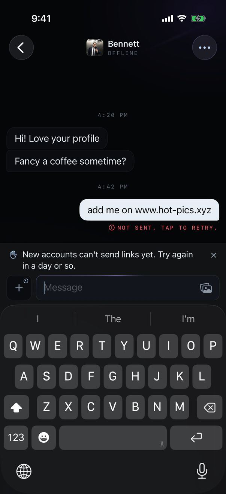

# Security and anti-spam

Stexx is anonymous: no phone numbers, no real names, no ID checks. So instead of asking people who they are, the server checks that requests come from a real iPhone running the real app, and that new accounts act like people rather than scripts. This doc covers the four "Before launch" controls from [`roadmap.md`](roadmap.md), plus reporting, auto-hide and moderator review (section 5): how they work, how to configure them, and what they store.

The anti-spam code lives in `server/src/lib/abuse/` (plus `server/src/routes/attest.ts`) and `ios/Stexx/Services/AttestationService.swift`; its schema is in `server/migrations/104_anti-spam.sql` and `105_abuse-counters.sql`. Reports and moderation are in `server/src/lib/moderation.ts`, `server/src/routes/safety.ts`, `server/src/moderation/cli.ts` and `server/migrations/107_report-autohide.sql`.

## Cost and footprint

Everything runs on the single VPS with what is already there: the Bun API and Postgres. No paid third-party service and no extra daemon (no Redis):

- Rate-limit state is in Postgres.
- The disposable-email list is a file bundled in the repo and loaded at boot; there are no lookups to an outside API.
- App Attest is verified locally against Apple's root certificate (shipped in the repo). DeviceCheck calls go to Apple's free API, and only if a DeviceCheck key is configured: on signup, login and account deletion (the per-device bits), and on each protected request from the rare device that can't use App Attest (token validation).

Photo moderation is not part of this work; it will come in a later change.

## 1. Device attestation (App Attest, DeviceCheck fallback)

**What it proves:** a request was made by a genuine, unmodified Stexx build on real Apple hardware. Scripts, emulators and repackaged apps can't produce a valid App Attest key.

**Flow**

1. On first launch the app creates an App Attest key (`DCAppAttestService.generateKey`).
2. It fetches a one-time challenge: `POST /v1/attest/challenge` → `{challenge, expiresAt}` (5 minutes, single use).
3. It asks Apple to attest the key against `SHA256(challenge)` and uploads the result: `POST /v1/attest/key {keyID, attestation, challenge}` → `204`.
   The server checks the certificate chain up to Apple's App Attest root (`server/certs/app-attest/`), the nonce extension, that `keyID` is the hash of the public key, the app ID (`TEAMID.gay.stexx.app`), the environment (`appattestdevelop` / `appattest`) and a zero counter. It stores only the public key and a counter in `devices`.
4. Protected requests then carry an **assertion**, a signature by that key over:

   ```text
   stexx-assert-v1\n<METHOD>\n<path>\n<timestampMs>\n<base64url(sha256(body))>
   ```

   in these headers: `X-Stexx-Key-Id`, `X-Stexx-Assertion`, `X-Stexx-Timestamp`. The server verifies the signature, a ±10 minute clock window and a monotonic counter (32 recent counters are kept so concurrent requests can arrive out of order; an exact replay is refused).
5. If the server says `attestation_key_unknown` (e.g. after a database reset), the app throws the key away, attests a new one and retries once.

**Fallback:** where App Attest isn't supported, the app sends a DeviceCheck token (`X-Stexx-Device-Token`), which the server validates with Apple. This is weaker (it proves an Apple device, not our app) and is only accepted when DeviceCheck is configured.

**Simulator / dev:** the simulator can't do App Attest. Builds using the **Stexx Local** scheme send `X-Stexx-Attestation: dev-bypass`, which only a server in `ATTESTATION_MODE=dev` accepts. Production refuses to boot in dev mode.

**Protected routes**

| Purpose | Routes | Needs attestation |
| --- | --- | --- |
| signup | `POST /v1/auth/register` (dev), `POST /v1/auth/passkey/register/finish` | yes |
| login | `POST /v1/auth/passkey/login/finish`, `POST /v1/auth/email/link`, `POST /v1/auth/email/verify` (which also runs the signup checks when it creates an account) | yes |
| message | `POST /v1/conversations/:id/messages` | yes |
| photo | `POST /v1/me/photos`, `POST /v1/me/attachments` | yes |
| optional | `DELETE /v1/me` | used if present (to free the device's account slot) |

**Modes** (`ATTESTATION_MODE`)

| Mode | Behavior |
| --- | --- |
| `off` | Headers are ignored. Default in tests, and in production while `APPLE_TEAM_ID` is unset (the server logs a warning). |
| `dev` | Real attestations are verified when present; `X-Stexx-Attestation: dev-bypass` is also accepted. Default in development. **Refused in production.** |
| `enforce` | Every protected route needs a valid assertion (or a DeviceCheck token, if configured). Default in production once `APPLE_TEAM_ID` is set. |

## 2. One account per device

- `device_accounts` links a device row to the accounts created on it. Signup is refused with `device_account_limit` once a device has `MAX_ACCOUNTS_PER_DEVICE` (default 1) live accounts. Deleting the account frees the slot (the row cascades).
- **Across reinstalls**, App Attest keys change, so the server also uses DeviceCheck's two per-device bits, which Apple stores and which survive reinstalls and resets:
  - bit 0: "an account was created on this device"
  - bit 1: "this device is banned"
  The app sends a DeviceCheck token alongside its assertion on signup. If bit 0 is set and the device has no live account in our table, signup is refused as `device_account_limit`; bit 1 gives `device_banned`. Deleting an account clears bit 0.
- A banned device (`devices.banned_at`) is refused at signup and login. `banDevicesOfUser()` marks every device of an account as banned and, the next time that device sends a DeviceCheck token, sets bit 1 at Apple. There is no moderator UI for this yet.
- Without DeviceCheck credentials the per-device cap still works per App Attest key, but a reinstall gets a fresh key.

## 3. Rate limits and disposable email

Sliding-window limits (the current window plus a weighted share of the previous one) per IP, per network (/24 for IPv4, /48 for IPv6), per device and per account. All windows for an action are checked before any is counted, so a refused request doesn't use up quota. Over the limit, the server returns **429** with `Retry-After` and `{code: "rate_limited"}`; the app turns that into a plain sentence ("Slow down a little…", "Try again in about 5 min.").

| Action | Per IP | Per network | Per device | Per account |
| --- | --- | --- | --- | --- |
| signup | 10 / 1h | 30 / 1h | 3 / 1d | – |
| login | 30 / 10m | – | 20 / 10m | – |
| message | 600 / 10m | – | 1500 / 1d | 1000 / 1d |
| photo | 120 / 1h | – | 60 / 1h | 60 / 1h |

Override any of them with `RATE_LIMIT_<ACTION>_<SCOPE>=<count>/<window>`, e.g. `RATE_LIMIT_SIGNUP_IP=5/1h`, `RATE_LIMIT_MESSAGE_ACCOUNT=500/1d`. These sit on top of the existing per-route token buckets in `lib/ratelimit.ts` (in memory, per minute). Because these windows run for hours and days, their counters live in Postgres (`abuse_counters`, migration 105): one small row per limit and subject, updated under a transaction-scoped advisory lock so concurrent requests can't overshoot, and kept across restarts and deploys. The retention job deletes rows once they can't affect a decision (at most two windows, so two days for the longest). `MemorySlidingWindowStore` implements the same interface for unit tests.

Device and account keys are opaque ids. IP and network keys are HMACs with a key derived from `EMAIL_PEPPER` (which is never in the database or its backups), so a stored key can't be turned back into an address; raw IPs are never written anywhere.

**Disposable email:** email sign-up refuses 10,400 known throwaway domains (`server/src/lib/abuse/disposable-domains.txt`, from the CC0 [disposable-email-domains](https://github.com/disposable-email-domains/disposable-email-domains) list) with `400 disposable_email`. Privacy relays that forward to a real inbox (Hide My Email, DuckDuckGo, SimpleLogin, Proton) are explicitly allowed, since they fit Stexx's anonymity. To refresh the list, replace the file and keep the allowlist in `email.ts`.

## 4. New-account limits (trust ramp)

An account is **restricted** while it is younger than `TRUST_RAMP_HOURS` (24) and fewer than `TRUST_RAMP_GRADUATE_REPLIES` (3) different people have replied to it, or while it has an open report and is less than 7 days old. Restricted accounts can browse, tap and reply normally, but:

| Code (403) | Rule |
| --- | --- |
| `links_not_allowed` | No URLs, bare domains (`example.xyz`, `t.me/...`) or `www.` links. |
| `new_account_limit` | At most `TRUST_RAMP_FIRST_MESSAGES_PER_DAY` (10) conversations started in 24h that nobody has replied to yet. |
| `duplicate_message` | The same text (case, spacing and punctuation ignored, 16+ characters) to more than `TRUST_RAMP_DUPLICATE_RECIPIENTS` (3) people in 24h. |

### With end-to-end encrypted chats

Chats are planned to become end-to-end encrypted with the Signal Protocol (libsignal); see "End-to-end encrypted chat" in [`roadmap.md`](roadmap.md). The rules above are split so that change doesn't undo them:

| Rule | Needs | Where it runs after E2EE |
| --- | --- | --- |
| Rate limits (section 3) | counts per IP, device, account | server, unchanged |
| `new_account_limit` (first contacts nobody replied to) | who wrote in which conversation, when | server, unchanged |
| Trust state (age, repliers, open reports) | account metadata | server, unchanged |
| `links_not_allowed` | message text | **the app**, before encrypting |
| `duplicate_message` (same text to many people) | message text | **the app**, against its own recently sent messages; no content hashes go to the server |
| Report evidence (section 5) | the reported messages | **the app** sends the plaintext of the messages the reporter ticks; the server checks only that message ids, thread and sender match |

The two text rules sit behind `ContentPolicy` in `server/src/lib/abuse/content.ts`. Today the server uses `plaintextContentPolicy`; when messages become ciphertext it switches to `encryptedContentPolicy` (a no-op) and the app runs the same rules locally. `containsLink` and `normalizeForDuplicate` are the reference to port. The server learns whether the sender is restricted from its own metadata, so it can tell the app which rules apply. A modified client can skip the in-app checks, which is why the metadata limits, which still bound fan-out, stay on the server.

The app shows the server's message above the composer and keeps the failed bubble so the user can edit or retry.

<p>
  
  
</p> Set `TRUST_RAMP_ENABLED=0` to turn the ramp off.

## 5. Reports, auto-hide and moderation

Reporting has to be fast for the person being harassed, and several independent reports should take an account out of circulation before a moderator gets to it, without letting one person (or one person with several accounts) knock someone offline.

### Reporting in the app

- **Two taps:** on a profile or in a chat, "•••" → **Report** opens the report sheet; "•••" → **Block** → confirm blocks. Safety actions are free.
- The sheet's reasons are exactly the server's: `underage`, `harassment`, `spam`, `fakeProfile`, `threatsOrViolence`, `illegalContent`, `other`. "Also block" is on by default. After sending, the sheet confirms ("Report sent", the person won't know who reported them, and that they're blocked).
- **Evidence from a chat:** "Include messages" lists the thread's last 30 messages; the reporter ticks up to 20. Only ticked messages are sent, as plaintext from the app, so this keeps working once chats are end-to-end encrypted. Photos aren't uploaded (the item says a photo was there). The server records whether each message id exists in that thread from the claimed sender (`verified`), which is all it will be able to check with E2EE.

### Auto-hide rules

Checked after every report, in the report's transaction, serialized per reported account (advisory lock). Only **open** reports filed in the last `REPORT_AUTOHIDE_WINDOW_DAYS` (14) **and after the account's last moderator review** count. Each reporter account counts once.

| Rule | Hides when |
| --- | --- |
| `reports` | `REPORT_AUTOHIDE_THRESHOLD` (3) **independent trusted** reporters, any reasons |
| `underage` | `REPORT_UNDERAGE_TRUSTED_THRESHOLD` (1) independent trusted reporter says `underage`, **or** `REPORT_UNDERAGE_ANY_THRESHOLD` (2) reporters say `underage` from different devices and connections, whatever their account age (a new account counts here only if it was created on an attested device, so each fake reporter costs a real iPhone) |

- **Trusted reporter:** at least `REPORT_REPORTER_MIN_AGE_HOURS` old (default `TRUST_RAMP_HOURS`, 24) and not restricted by the trust ramp (section 4). Replies don't shorten this: sock-puppet accounts can reply to each other, but they can't age faster.
- **Never counted:** reporters that are themselves hidden or banned, and anonymized reports (the reporter deleted their account).
- **Independent:** reporters must not share a device (`device_accounts`, from section 2) or the connection they reported from (`reports.reporter_ip_hash`: the same keyed HMAC as the rate limits, of the IPv4 address or the IPv6 /64, never the address). Each reporter counts once however many reports they file, and the assessment looks at up to 500 reporters (not reports), so one account filing over and over can't push others out. Earlier reporters win: a later reporter on a device or IP already counted is skipped. People reporting from the same venue Wi-Fi therefore count once; that only makes auto-hide more conservative, and moderators still see every report.
- **Why underage is faster:** a minor on the app is the worst case, so one established reporter is enough to hide the account immediately, and it goes to the top of the queue (priority `high`). The cost of a false report is a short hidden period until review, never a ban. **Trade-off:** any account older than a day can hide anyone this way, with no prior contact. That's accepted because hiding is reversible and reviewed first; set `REPORT_UNDERAGE_TRUSTED_THRESHOLD=2` if it gets abused, and watch for reporters whose underage reports keep being dismissed (`log`).

### What a hidden account sees and can do

| | Hidden (after reports or by a moderator) | Banned |
| --- | --- | --- |
| Nearby, viewers | gone for everyone | gone |
| Profile, conversation list, favorite, tap target | 404 / missing, **except** for people who have written to them (their existing chats keep working) | gone everywhere, including existing chats (404) |
| Start a chat, write first, tap | 403 `account_under_review` (may only reply where the other person has written) | can't sign in |
| Sessions | unchanged | revoked; sign-in refused with 403 `account_banned`; every device it was created on is banned (section 2) |

The hidden account is told it is under review (the 403 message, and `hiddenPendingReviewSince` in its data export) but never who reported it, how many people did, or why. Report responses are always 204, so reporters can't tell whether an account was hidden either.

### Moderator review (CLI)

No web admin and no third-party tool: moderation is a command on the server, run over SSH as the service user with the service's environment. Every write is one transaction and adds a row to `moderation_actions` (actor handle, action, account, report ids, note, details).

```sh
# on the VPS
stexx-mod() {
  sudo bash -c 'set -a; . /etc/stexx/stexx.env; set +a; export NODE_ENV=production HOST=127.0.0.1 PORT=8787 MEDIA_DIR=/srv/stexx/media
    cd /srv/stexx/current && HOME=/nonexistent exec setpriv --reuid=stexx --regid=stexx --clear-groups /usr/local/bin/bun scripts/moderate.ts "$@"' _ "$@"
}
stexx-mod list                                   # queue: underage first, then hidden accounts, oldest report first
stexx-mod show p_abc…                            # profile text, reports, shared messages, how each reporter was judged, history
stexx-mod dismiss p_abc… --as mod-a --note "brigading"
stexx-mod ban p_abc… --as mod-a --note "illegal content"
```

Locally: `cd server && bun run moderate -- list`. Add `--json` to `list`, `show` and `log` for machine-readable output.

| Command | Effect |
| --- | --- |
| `list [--limit N]` | Accounts with open reports, plus hidden ones: underage first, then hidden, then oldest open report |
| `show <profileID>` | Profile text (name, age, headline, about; never location), open and recent closed reports with details and shared messages, the auto-hide assessment per reporter, audit history. Never the chat thread itself |
| `dismiss <profileID>` | Reports unfounded: close every open report as dismissed and unhide. `--report <id>` closes just that one and leaves the account as it is |
| `action <profileID> [--unhide]` | Reports valid but handled without a ban (e.g. the person was asked to change a photo): close them as actioned; stays hidden unless `--unhide` |
| `hide` / `unhide <profileID>` | Hide pending review / make visible. Open reports stay open, but only reports filed after a review count towards the next auto-hide |
| `ban <profileID>` | See the table above. The account row is kept so its email hash and devices keep blocking a new sign-up |
| `unban <profileID>` | Undo a ban: clears the ban, the hide and the server-side ban on its devices (unless another banned account was created on the same device). A DeviceCheck ban bit already written at Apple stays set |
| `log [<profileID>]` | Audit log |

Options that don't belong to a command are refused rather than ignored. Write commands need `--as <handle>` (or `STEXX_MODERATOR`): letters, digits, `.`, `-`, `_`; use a handle, never a real name. `system` is reserved for automatic hides.

### Retention

- `report_evidence` rows, the report's free-text `details` and `reporter_ip_hash` are deleted by the slow retention job `REPORT_EVIDENCE_RETENTION_DAYS` (30) after a report is closed, 30 days after filing if the reported account was deleted, and in any case `REPORT_EVIDENCE_MAX_DAYS` (180) after filing.
- The report row itself (reason, priority, status, dates) stays for history; account deletion anonymizes it (`SET NULL`) as before. `moderation_actions` is kept and anonymized the same way.
- Evidence a reporter shared is part of their data export while it exists.
- If the reporter deletes their account, the report is anonymized but its evidence keeps the same clock, so a harassed person leaving the app doesn't erase the evidence against the harasser. If the reported account is deleted, the evidence goes 30 days after the report was filed.

## Error codes the app handles

| Status | Code | Shown as |
| --- | --- | --- |
| 403 | `attestation_required`, `attestation_invalid`, `attestation_clock`, `attestation_unavailable`, `attestation_unconfigured` | The server's message, e.g. "We couldn't verify this device. Please try again in the Stexx app." or "Your phone's clock looks off…" |
| 403 | `attestation_key_unknown` | Not shown: the app re-attests and retries once |
| 403 | `device_banned`, `device_account_limit` | Server message on the sign-up screen |
| 400 | `disposable_email` | "Please use a regular email address. Temporary inboxes aren't supported." |
| 403 | `links_not_allowed`, `new_account_limit`, `duplicate_message` | Server message above the chat composer |
| 403 | `account_under_review` | Server message where the chat or tap failed |
| 403 | `account_banned` | Server message on the sign-in screen |
| 429 | `rate_limited` | Friendly sentence built from `Retry-After` |

## Configuration

| Variable | Default | Notes |
| --- | --- | --- |
| `ATTESTATION_MODE` | dev (development), off (test), enforce if `APPLE_TEAM_ID` is set else off (production) | `off` / `dev` / `enforce`. `dev` is refused in production. |
| `APPLE_TEAM_ID` | unset | 10-character Team ID. App ID = `TEAMID.APPLE_BUNDLE_ID`. |
| `APP_ATTEST_ENVIRONMENTS` | `production` (prod), `development,production` (otherwise) | Which App Attest environments to accept. |
| `APP_ATTEST_ROOT_CA` | `server/certs/app-attest/Apple_App_Attestation_Root_CA.pem` | Apple's public root, shipped in the repo. |
| `DEVICECHECK_KEY_ID` | unset | Key ID of the DeviceCheck key (.p8) from the Apple Developer account. |
| `DEVICECHECK_PRIVATE_KEY` / `DEVICECHECK_PRIVATE_KEY_PATH` | unset | The .p8 contents (one line, `\n` escaped) or a path to it. All three of key ID, team ID and key are needed to enable DeviceCheck. |
| `DEVICECHECK_ENVIRONMENT` | `production` (prod), `development` (otherwise) | Which DeviceCheck API host to call. |
| `MAX_ACCOUNTS_PER_DEVICE` | `1` | 1–20. |
| `TRUST_RAMP_ENABLED` | `1` | |
| `TRUST_RAMP_HOURS` | `24` | |
| `TRUST_RAMP_FIRST_MESSAGES_PER_DAY` | `10` | |
| `TRUST_RAMP_DUPLICATE_RECIPIENTS` | `3` | |
| `TRUST_RAMP_GRADUATE_REPLIES` | `3` | |
| `RATE_LIMIT_*` | see table above | `<count>/<window>`, window like `30s`, `10m`, `1h`, `1d`. |
| `REPORT_AUTOHIDE_ENABLED` | `1` | Set `0` to keep reports but never auto-hide. |
| `REPORT_AUTOHIDE_THRESHOLD` | `3` | Independent trusted reporters that hide an account. |
| `REPORT_AUTOHIDE_WINDOW_DAYS` | `14` | |
| `REPORT_UNDERAGE_TRUSTED_THRESHOLD` | `1` | |
| `REPORT_UNDERAGE_ANY_THRESHOLD` | `2` | |
| `REPORT_REPORTER_MIN_AGE_HOURS` | `TRUST_RAMP_HOURS` | |
| `REPORT_EVIDENCE_RETENTION_DAYS` | `30` | After the report is closed. |
| `REPORT_EVIDENCE_MAX_DAYS` | `180` | Cap for reports that stay open. |

iOS build settings (`ios/project.yml`): `STEXX_ATTESTATION_MODE` (`attest`; `dev-bypass` in the Local configuration) and `STEXX_APP_ATTEST_ENVIRONMENT` (`development`; `production` in Release), which feeds the `com.apple.developer.devicecheck.appattest-environment` entitlement in the generated `Stexx/Stexx.entitlements`.

## Turning it on for production (manual steps)

1. **App Attest capability:** in the Apple Developer account, enable App Attest for the `gay.stexx.app` identifier (Xcode's automatic signing does this when it sees the entitlement). Regenerate profiles if signing manually.
2. **DeviceCheck key:** Certificates, Identifiers & Profiles → Keys → new key with **DeviceCheck** enabled. Download the `.p8` once and store it in the password manager. Note its Key ID.
3. **Server env** (`/etc/stexx/stexx.env`, root 0600): set `APPLE_TEAM_ID`, `DEVICECHECK_KEY_ID`, and `DEVICECHECK_PRIVATE_KEY` (the .p8 on one line with `\n` escapes, quoted) or `DEVICECHECK_PRIVATE_KEY_PATH` to a file the service can read. Leave `ATTESTATION_MODE` unset (enforce) or set it explicitly.
4. **Ship an app build with attestation before enforcing.** Once `APPLE_TEAM_ID` is set, older builds that don't send assertions can't sign up, log in, message or upload photos. To stage it, set `ATTESTATION_MODE=off` first and flip to `enforce` after the attesting build is out.
5. Check the boot log: it prints the attestation mode and whether DeviceCheck is enabled.

## Privacy

- No hardware identifiers: App Attest keys are per-install and app-scoped; DeviceCheck gives two bits Apple keeps for us. We never see a serial number, IDFA or IDFV.
- `devices` holds a public key, a counter, the attestation environment, a ban timestamp and the last-seen **date** (not time). Idle devices with no accounts are purged after 90 days by the retention job, along with expired challenges.
- Raw IPs are never stored. Rate-limit rows hold an HMAC of the IP or /24 network (key derived from `EMAIL_PEPPER`) and disappear within two windows.
- The trust ramp reads message metadata the server already has (sender, conversation, time, text for the duplicate check); nothing new is collected.
- Reports add two things: the messages a reporter chooses to share, and a keyed hash of the reporter's IP at report time (to tell reports from one connection apart). Both are deleted within 30 days of the report closing (180 days at most). Nothing in moderation stores or shows a location.

## Not done yet

- Report evidence can't include photos yet (only that a photo was sent). With E2EE, the app would need to re-encrypt the chosen photo for moderators; that comes with the E2EE work.
- No web moderation UI or admin HTTP API: the CLI over SSH is deliberate (no new network surface). Review turnaround depends on someone running `list`; there are no notifications for new high-priority reports yet.
- The "Report" and "Block" menus were checked by hand; there are no UI tests for them.
- Tests against a real-device attestation: the suite uses a synthetic root and devices generated by `server/test/fixtures/app-attest/generate.ts`. Do one manual sign-up on a physical iPhone against a staging server before enforcing.
- The DeviceCheck "banned" bit is written on the device's next request with a token, not immediately at ban time.
