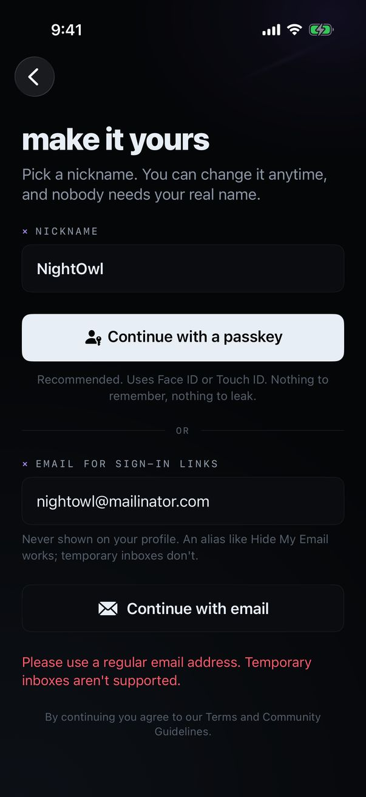

# Security and anti-spam

Stexx is anonymous: no phone numbers, no real names, no ID checks. So instead of asking people who they are, the server checks that requests come from a real iPhone running the real app, and that new accounts act like people rather than scripts. This doc covers the four "Before launch" controls from [`roadmap.md`](roadmap.md), plus reporting, auto-hide and moderator review (section 5), profile photo checks (section 6), the server side of end-to-end encrypted chat (section 7) and spam heuristics on messages with shadow limits (section 8): how they work, how to configure them, and what they store.

The anti-spam code lives in `server/src/lib/abuse/` (plus `server/src/routes/attest.ts`) and `ios/Stexx/Services/AttestationService.swift`; its schema is in `server/migrations/104_anti-spam.sql` and `105_abuse-counters.sql`. Reports and moderation are in `server/src/lib/moderation.ts`, `server/src/routes/safety.ts`, `server/src/moderation/cli.ts` and `server/migrations/107_report-autohide.sql`; moderator alerts and photo-flag review in `server/src/lib/moderator-alerts.ts`, `server/src/lib/photocheck/review.ts`, `server/src/moderation/photos-cli.ts` and `server/migrations/114_mod-tools.sql`.

## Cost and footprint

Everything runs on the single VPS with what is already there: the Bun API and Postgres. No paid third-party service and no extra daemon (no Redis):

- Rate-limit state is in Postgres.
- Moderator alerts go out through the SMTP relay already used for sign-in links, or to a webhook you host (e.g. ntfy or a Matrix bridge on the same box). Their debounce state is in Postgres.
- The disposable-email list is a file bundled in the repo and loaded at boot; there are no lookups to an outside API.
- App Attest is verified locally against Apple's root certificate (shipped in the repo). DeviceCheck calls go to Apple's free API, and only if a DeviceCheck key is configured: on signup, login and account deletion (the per-device bits), and on each protected request from the rare device that can't use App Attest (token validation).

- The staff console is a second small process (no jobs) behind Caddy on the same box, reached over Tailscale. Tailscale is the one outside service it needs (free for a small team; its coordination server sees device names, not traffic). See [section 9](#9-staff-console).
- The nudity classifier for profile photos is a 12 MB open-source model run in-process on the CPU (about 10 ms a photo); the file is downloaded once at deploy, pinned by checksum. See [section 6](#6-photo-checks-profile-photos).
- `@signalapp/libsignal-client` is a native module pulled at deploy (about 44 MB unpacked on Linux). Signature checks run in-process; a built-in verifier is used if the module fails to load. See [section 7](#7-end-to-end-encrypted-chat).

## 1. Device attestation (App Attest, DeviceCheck fallback)

**What it proves:** a request was made by a genuine, unmodified Stexx build on real Apple hardware. Scripts, emulators and repackaged apps can't produce a valid App Attest key.

**Flow**

1. On first launch the app creates an App Attest key (`DCAppAttestService.generateKey`).
2. It fetches a one-time challenge: `POST /v1/attest/challenge` → `{challenge, expiresAt}` (5 minutes, single use).
3. It asks Apple to attest the key against `SHA256(challenge)` and uploads the result: `POST /v1/attest/key {keyID, attestation, challenge}` → `204`.
   The server checks the certificate chain up to Apple's App Attest root (`server/certs/app-attest/`), the nonce extension, that `keyID` is the hash of the public key, the app ID (`TEAMID.gay.stexx.app`), the environment (`appattestdevelop` / `appattest`) and a zero counter. It stores only the public key and a counter in `devices`.
4. Protected requests then carry an **assertion**, a signature by that key over:

   ```text
   stexx-assert-v1\n<METHOD>\n<path>\n<timestampMs>\n<base64url(sha256(body))>
   ```

   in these headers: `X-Stexx-Key-Id`, `X-Stexx-Assertion`, `X-Stexx-Timestamp`. The server verifies the signature, a ±10 minute clock window and a monotonic counter (32 recent counters are kept so concurrent requests can arrive out of order; an exact replay is refused).
5. If the server says `attestation_key_unknown` (e.g. after a database reset), the app throws the key away, attests a new one and retries once.

**Fallback:** where App Attest isn't supported, the app sends a DeviceCheck token (`X-Stexx-Device-Token`), which the server validates with Apple. This is weaker (it proves an Apple device, not our app) and is only accepted when DeviceCheck is configured.

**Simulator / dev:** the simulator can't do App Attest. Builds using the **Stexx Local** scheme send `X-Stexx-Attestation: dev-bypass`, which only a server in `ATTESTATION_MODE=dev` accepts. Production refuses to boot in dev mode.

**Protected routes**

| Purpose | Routes | Needs attestation |
| --- | --- | --- |
| signup | `POST /v1/auth/register` (dev), `POST /v1/auth/passkey/register/finish` | yes |
| login | `POST /v1/auth/passkey/login/finish`, `POST /v1/auth/email/link`, `POST /v1/auth/email/verify`, `POST /v1/auth/email/code` (the last two also run the signup checks when they create an account) | yes |
| message | `POST /v1/conversations/:id/messages`, `PUT /v1/keys`, `GET /v1/keys/bundle/:id` | yes |
| photo | `POST /v1/me/photos`, `POST /v1/me/attachments` | yes |
| optional | `DELETE /v1/me` | used if present (to free the device's account slot) |

**Modes** (`ATTESTATION_MODE`)

| Mode | Behavior |
| --- | --- |
| `off` | Headers are ignored. Default in tests, and in production while `APPLE_TEAM_ID` is unset (the server logs a warning). |
| `dev` | Real attestations are verified when present; `X-Stexx-Attestation: dev-bypass` is also accepted. Default in development. **Refused in production.** |
| `enforce` | Every protected route needs a valid assertion (or a DeviceCheck token, if configured). Default in production once `APPLE_TEAM_ID` is set. |

## 2. One account per device

- `device_accounts` links a device row to the accounts created on it. Signup is refused with `device_account_limit` once a device has `MAX_ACCOUNTS_PER_DEVICE` (default 1) live accounts. Deleting the account frees the slot (the row cascades).
- **Across reinstalls**, App Attest keys change, so the server also uses DeviceCheck's two per-device bits, which Apple stores and which survive reinstalls and resets:
  - bit 0: "an account was created on this device"
  - bit 1: "this device is banned"
  The app sends a DeviceCheck token alongside its assertion on signup. If bit 0 is set and the device has no live account in our table, signup is refused as `device_account_limit`; bit 1 gives `device_banned`. Deleting an account clears bit 0.
- A banned device (`devices.banned_at`) is refused at signup and login. `banDevicesOfUser()` marks every device of an account as banned and, the next time that device sends a DeviceCheck token, sets bit 1 at Apple. There is no moderator UI for this yet.
- Without DeviceCheck credentials the per-device cap still works per App Attest key, but a reinstall gets a fresh key.

## 3. Rate limits and disposable email

Sliding-window limits (the current window plus a weighted share of the previous one) per IP, per network (/24 for IPv4, /48 for IPv6), per device and per account. All windows for an action are checked before any is counted, so a refused request doesn't use up quota. Over the limit, the server returns **429** with `Retry-After` and `{code: "rate_limited"}`; the app turns that into a plain sentence ("Slow down a little…", "Try again in about 5 min.").

| Action | Per IP | Per network | Per device | Per account |
| --- | --- | --- | --- | --- |
| signup | 10 / 1h | 30 / 1h | 3 / 1d | – |
| login | 30 / 10m | – | 20 / 10m | – |
| message | 600 / 10m | – | 1500 / 1d | 1000 / 1d |
| photo | 120 / 1h | – | 60 / 1h | 60 / 1h |
| key bundle fetch (section 7) | 300 / 1h | – | 300 / 1d | 200 / 1d |
| key registration, `PUT /v1/keys` | – | – | – | 10 / 1d |

Override any of them with `RATE_LIMIT_<ACTION>_<SCOPE>=<count>/<window>`, e.g. `RATE_LIMIT_SIGNUP_IP=5/1h`, `RATE_LIMIT_MESSAGE_ACCOUNT=500/1d` (key limits: `RATE_LIMIT_KEY_BUNDLE_ACCOUNT`, `…_DEVICE`, `…_IP`, `RATE_LIMIT_KEY_REGISTER_ACCOUNT`, and the prekey budgets `RATE_LIMIT_PREKEY_TARGET`, `RATE_LIMIT_PREKEY_PAIR`). These sit on top of the existing per-route token buckets in `lib/ratelimit.ts` (in memory, per minute). Because these windows run for hours and days, their counters live in Postgres (`abuse_counters`, migration 105): one small row per limit and subject, updated under a transaction-scoped advisory lock so concurrent requests can't overshoot, and kept across restarts and deploys. The retention job deletes rows once they can't affect a decision (at most two windows, so two days for the longest). `MemorySlidingWindowStore` implements the same interface for unit tests.

**Email sign-in codes.** Every sign-in email carries a link (a 32-byte token) and an 8-digit code for the same sign-in, both single use and valid for 15 minutes (the link stored as a SHA-256 hash; the code as an HMAC-SHA256 under a key derived from `EMAIL_PEPPER`, bound to the address's HMAC, so someone who can read the database or a backup but not the pepper can't try the 10^8 codes offline). Each email is bound to the app install that asked for it: the app sends a random 32-byte request nonce with `POST /auth/email/link`, keeps it in the Keychain (this device only) while it waits, and the row stores its SHA-256 (`request_nonce_hash`).

- **Codes only work in the asking install.** `POST /auth/email/code` needs the nonce, and a guess only ever tests, and counts against, the codes that install asked for. A stranger who knows someone's address therefore can't use up or switch off their code. Guessing is capped three ways: 5 wrong codes switch off the codes of that install's emails (their links keep working), at most 10 code attempts per address per client per hour (`emailCode` in `lib/ratelimit.ts`), and the per-client `auth` and `login` limits. To have codes to guess at, an attacker must ask for the emails themselves, at most 3 per 15 minutes per client and 8 per 15 minutes per address, and every one lands in the owner's inbox. So at most 5 guesses per code against 10^8 codes, at most 160 guesses an hour, and only while flooding the inbox with 32 emails an hour from several attested devices: about 1 in 600,000 per hour.
- **Links opened elsewhere ask first (login CSRF).** Anyone can ask for a link to their own account and send it to someone whose app is signed out; opening it would put that phone into the sender's account, and the victim's location cell, photos and chats would land where the sender can read them. So `POST /auth/email/verify` gets the app's nonce: a link this install asked for signs in at once; any other link gets `409 confirm_link` with the account's nickname and whether it would be a new account, and is left unused. The app shows "Sign in as *nickname*?" (or "Create the account *nickname*?"), says it wasn't asked for in this app, and only on yes sends it again with `confirmed: true`. Nothing starts (location, realtime) before that. The app also only accepts `https` links on the configured app-link host (`STEXX_APP_LINK_HOST`).

Device and account keys are opaque ids. IP and network keys are HMACs with a key derived from `EMAIL_PEPPER` (which is never in the database or its backups), so a stored key can't be turned back into an address; raw IPs are never written anywhere.

**Disposable email:** email sign-up refuses 10,400 known throwaway domains (`server/src/lib/abuse/disposable-domains.txt`, from the CC0 [disposable-email-domains](https://github.com/disposable-email-domains/disposable-email-domains) list) with `400 disposable_email`. Privacy relays that forward to a real inbox (Hide My Email, DuckDuckGo, SimpleLogin, Proton) are explicitly allowed, since they fit Stexx's anonymity. To refresh the list, replace the file and keep the allowlist in `email.ts`.

## 4. New-account limits (trust ramp)

An account is **restricted** while it is younger than `TRUST_RAMP_HOURS` (24) and fewer than `TRUST_RAMP_GRADUATE_REPLIES` (3) different people have replied to it, or while it has an open report and is less than 7 days old. Restricted accounts can browse, tap and reply normally, but:

| Code (403) | Rule |
| --- | --- |
| `links_not_allowed` | No URLs, bare domains (`example.xyz`, `t.me/...`) or `www.` links. |
| `handles_not_allowed` | No payment or crypto handles (Cash App `$tags`, Venmo, PayPal.me, Zelle, wallet addresses) and no off-platform redirects (Telegram, WhatsApp, Snapchat, Instagram, Kik, Signal usernames, OnlyFans), from the shared table in section 8. |
| `new_account_limit` | At most `TRUST_RAMP_FIRST_MESSAGES_PER_DAY` (10) conversations started in 24h that nobody has replied to yet. Counted from the messages and from the spam heuristics' ledger (`spam_contacts`, section 8), so a first message that expires right after it is read still counts. |
| `duplicate_message` | The same text (case, spacing and punctuation ignored, 16+ characters) to more than `TRUST_RAMP_DUPLICATE_RECIPIENTS` (3) people in 24h. |

### With end-to-end encrypted chats

Chats are planned to become end-to-end encrypted with the Signal Protocol (libsignal); see "End-to-end encrypted chat" in [`roadmap.md`](roadmap.md). The rules above are split so that change doesn't undo them:

| Rule | Needs | Where it runs after E2EE |
| --- | --- | --- |
| Rate limits (section 3) | counts per IP, device, account | server, unchanged |
| `new_account_limit` (first contacts nobody replied to) | who wrote in which conversation, when | server, unchanged |
| Trust state (age, repliers, open reports) | account metadata | server, unchanged |
| `links_not_allowed` | message text | **the app**, before encrypting |
| `handles_not_allowed` | message text | **the app**, before encrypting, from the same pattern table as the server (section 8) |
| `duplicate_message` (same text to many people) | message text | **the app**, against its own recently sent messages; no content hashes go to the server |
| Report evidence (section 5) | the reported messages and photos | **the app** sends the plaintext of the messages the reporter ticks, and re-uploads the photos it decrypted; the server checks only that message ids, thread and sender match |
| Explicit chat photos | the photo | **the app**, on the device before showing an incoming photo (section 7, "Encrypted photos") |

The text rules sit behind `ContentPolicy` in `server/src/lib/abuse/content.ts`. The choice is per message: plaintext `text` goes through the current policy (`plaintextContentPolicy`), and an encrypted envelope (section 7) goes through `encryptedContentPolicy` (a no-op), so both work side by side while `E2E_MODE=optional`. The app runs the same rules locally before encrypting; `containsLink` and `normalizeForDuplicate` are the reference to port. The server tells the app whether its account is restricted, and with which numbers, in `GET /v1/e2e/config` → `contentRules`. A modified client can skip the in-app checks, which is why the metadata limits, which still bound fan-out, stay on the server and count encrypted messages exactly like plaintext ones.

The app shows the server's message above the composer and keeps the failed bubble so the user can edit or retry.

<p>
  
  
</p> Set `TRUST_RAMP_ENABLED=0` to turn the ramp off.

## 5. Reports, auto-hide and moderation

Reporting has to be fast for the person being harassed, and several independent reports should take an account out of circulation before a moderator gets to it, without letting one person (or one person with several accounts) knock someone offline.

### Reporting in the app

- **Two taps:** on a profile or in a chat, "•••" → **Report** opens the report sheet; "•••" → **Block** → confirm blocks. Safety actions are free.
- The sheet's reasons are exactly the server's: `underage`, `harassment`, `spam`, `fakeProfile`, `threatsOrViolence`, `illegalContent`, `other`. "Also block" is on by default. After sending, the sheet confirms ("Report sent", the person won't know who reported them, and that they're blocked).
- **Evidence from a chat:** "Include messages" lists the thread's last 30 messages; the reporter ticks up to 20. Only ticked messages are sent, as plaintext from the app, so this keeps working with end-to-end encrypted chats. A ticked photo is sent too: the app takes the photo it decrypted, re-encodes it as a JPEG, uploads it with `POST /v1/me/attachments` (sanitized by the server like any upload) and passes the upload's id as the item's `photoID`; the report consumes the upload. Moderators therefore see only the photos the reporter chose to share, never the rest of the thread. `moderate show` prints `photo: <path under MEDIA_DIR>` under the item (and `--json` has `photoPath`); the path appears nowhere else. At most 10 photos per report (the pending-upload cap); a photo the app can't show any more (expired, opened view-once, not on this phone) is sent as "there was a photo" without the image. The server records whether each message id exists in that thread from the claimed sender (`verified`), which is all it can check with E2EE: it can't tell whether a re-uploaded photo is the one that was in the chat.

### Auto-hide rules

Checked after every report, in the report's transaction, serialized per reported account (advisory lock). Only **open** reports filed in the last `REPORT_AUTOHIDE_WINDOW_DAYS` (14) **and after the account's last moderator review** count. Each reporter account counts once.

| Rule | Hides when |
| --- | --- |
| `reports` | `REPORT_AUTOHIDE_THRESHOLD` (3) **independent trusted** reporters, any reasons |
| `underage` | `REPORT_UNDERAGE_TRUSTED_THRESHOLD` (1) independent trusted reporter says `underage`, **or** `REPORT_UNDERAGE_ANY_THRESHOLD` (2) reporters say `underage` from different devices and connections, whatever their account age (a new account counts here only if it was created on an attested device, so each fake reporter costs a real iPhone) |

- **Trusted reporter:** at least `REPORT_REPORTER_MIN_AGE_HOURS` old (default `TRUST_RAMP_HOURS`, 24) and not restricted by the trust ramp (section 4). Replies don't shorten this: sock-puppet accounts can reply to each other, but they can't age faster.
- **Never counted:** reporters that are themselves hidden or banned, and anonymized reports (the reporter deleted their account).
- **Independent:** reporters must not share a device (`device_accounts`, from section 2) or the connection they reported from (`reports.reporter_ip_hash`: the same keyed HMAC as the rate limits, of the IPv4 address or the IPv6 /64, never the address). Each reporter counts once however many reports they file, and the assessment looks at up to 500 reporters (not reports), so one account filing over and over can't push others out. Earlier reporters win: a later reporter on a device or IP already counted is skipped. People reporting from the same venue Wi-Fi therefore count once; that only makes auto-hide more conservative, and moderators still see every report.
- **Why underage is faster:** a minor on the app is the worst case, so one established reporter is enough to hide the account immediately, and it goes to the top of the queue (priority `high`). The cost of a false report is a short hidden period until review, never a ban. **Trade-off:** any account older than a day can hide anyone this way, with no prior contact. That's accepted because hiding is reversible and reviewed first; set `REPORT_UNDERAGE_TRUSTED_THRESHOLD=2` if it gets abused, and watch for reporters whose underage reports keep being dismissed (`log`).

### What a hidden account sees and can do

| | Hidden (after reports or by a moderator) | Banned |
| --- | --- | --- |
| Nearby, viewers | gone for everyone | gone |
| Profile, conversation list, favorite, tap target | 404 / missing, **except** for people who have written to them (their existing chats keep working) | gone everywhere, including existing chats (404) |
| Start a chat, write first, tap | 403 `account_under_review` (may only reply where the other person has written) | can't sign in |
| Sessions | unchanged | revoked; sign-in refused with 403 `account_banned`; every device it was created on is banned (section 2) |
| Data | kept | kept intact for `BANNED_RETENTION_DAYS` (30), then purged like `DELETE /me` (see "Banned accounts: review window and purge" below) |

The hidden account is told it is under review (the 403 message, and `hiddenPendingReviewSince` in its data export) but never who reported it, how many people did, or why. Report responses are always 204, so reporters can't tell whether an account was hidden either.

### Moderator review (CLI)

No third-party tool: moderation is a command on the server, run over SSH as the service user with the service's environment. (A private web console, [section 9](#9-staff-console), is being built next to it; today it only does staff sign-in and management, and this CLI stays as break-glass.) Every write is one transaction and adds a row to `moderation_actions` (actor handle, action, account, report ids, note, details).

```sh
# on the VPS
stexx-mod() {
  sudo bash -c 'set -a; . /etc/stexx/stexx.env; [ -r /etc/stexx/admin.env ] && . /etc/stexx/admin.env; set +a; export NODE_ENV=production HOST=127.0.0.1 PORT=8787 MEDIA_DIR=/srv/stexx/media
    cd /srv/stexx/current && HOME=/nonexistent exec setpriv --reuid=stexx --regid=stexx --clear-groups /usr/local/bin/bun scripts/moderate.ts "$@"' _ "$@"
}
stexx-mod list                                   # queue: underage first, then hidden accounts, oldest report first
stexx-mod show p_abc…                            # profile text, reports, shared messages, how each reporter was judged, history
stexx-mod dismiss p_abc… --as mod-a --note "brigading"
stexx-mod ban p_abc… --as mod-a --note "illegal content"
stexx-mod photos list                            # photo flags: blocklist hits first, then duplicates
stexx-mod photos blocklist 12 --as mod-a --label "stock set"
stexx-mod alerts status                          # alert channels: last digest, failures, pending items
stexx-mod purge p_abc… --as mod-a --yes          # banned only: delete it now instead of after the review window
stexx-mod lift-email-ban --as mod-a --note "appeal upheld"   # then type the address and Ctrl-D (read from stdin)
stexx-mod staff invite admin-1 --role admin --as admin-1   # staff console accounts, see section 9 (also: staff list, staff disable, staff audit)
```

Locally: `cd server && bun run moderate -- list`. Add `--json` to `list`, `show` and `log` for machine-readable output.

| Command | Effect |
| --- | --- |
| `list [--limit N]` | Accounts with open reports, plus hidden ones: underage first, then hidden, then oldest open report |
| `show <profileID>` | Profile text (name, age, headline, about; never location), open and recent closed reports with details and shared messages, the auto-hide assessment per reporter, audit history. Never the chat thread itself |
| `dismiss <profileID>` | Reports unfounded: close every open report as dismissed and unhide. `--report <id>` closes just that one and leaves the account as it is |
| `action <profileID> [--unhide]` | Reports valid but handled without a ban (e.g. the person was asked to change a photo): close them as actioned; stays hidden unless `--unhide` |
| `hide` / `unhide <profileID>` | Hide pending review / make visible. Open reports stay open, but only reports filed after a review count towards the next auto-hide |
| `ban <profileID>` | See the table above. The account is kept intact for the review window (`BANNED_RETENTION_DAYS`, 30), then purged; the output says when (`purgeDue`), and so does `show` |
| `unban <profileID>` | Undo a ban (a mistake, or an appeal upheld inside the window): clears the ban and the hide, which cancels the purge, and the server-side ban on its devices (unless another banned account was created on the same device, still present or already purged). A DeviceCheck ban bit already written at Apple stays set |
| `purge <profileID> --yes` | Purge a banned account now instead of at the end of the window, for clear-cut cases. Refused unless the account is banned, refused without `--yes`, takes no `--note`. Irreversible. Audited as `purge` |
| `lift-email-ban` | After a purge: let the banned address sign up again (an appeal upheld too late for `unban`). Reads the address from stdin, never an argument, so it stays out of shell history; only its HMAC is looked up. Audited as `lift_email_ban` with the actor and note only (no account, address or hash). Exit code 1 when the address isn't banned. The device bans stay (a phone ban can only be cleared by hand, and its DeviceCheck bit not at all) |
| `log [<profileID>]` | Audit log |
| `spam [<profileID>]`, `spam-clear <profileID>` | Spam shadow limits: the list, one account's signals and counters, and clearing a false positive (section 8) |
| `photos …` | Review `photo_flags`, see [section 6](#reviewing-photo-flags) |
| `alerts status` / `alerts test` | Alert channels, last digest, pending items / send a test alert now, see [Alerts](#alerts) |

Options that don't belong to a command are refused rather than ignored. Write commands need `--as <handle>` (or `STEXX_MODERATOR`): letters, digits, `.`, `-`, `_`; use a handle, never a real name. `system` is reserved for automatic hides and purges.

### Banned accounts: review window and purge

A ban takes the account out of circulation at once, but deleting it at once would leave no room to correct a mistake, and keeping it forever would keep someone's photos, messages and location indefinitely, with no way for them to delete it (they can't sign in, so `DELETE /me` is out of reach). So:

1. **Review window.** For `BANNED_RETENTION_DAYS` (default **30**: long enough for an appeal through support and a second look, short enough that a banned person's data doesn't linger) the account stays exactly as the ban left it. `unban` during the window restores it and cancels the purge; a later ban starts a new window.
   **Bans made before the purge shipped** (migration 123) get a full window from the deploy, not from the ban: the migration sets `users.purge_window_start` to the deploy time for every account banned then, and the window starts at whichever is later. So the first run after the deploy purges nothing; existing bans are purged `BANNED_RETENTION_DAYS` after the deploy unless unbanned. `ban` and `unban` clear the column, so it only ever applies to those older bans. `show` prints the actual due date.
2. **Purge.** After the window the slow retention job (every 10 minutes, `purgeBannedAccounts`) deletes the account with the same code as `DELETE /me` (`lib/account.ts`): every table that references the account cascades, its photo and attachment files are unlinked, pending sign-in links for its address are dropped. Accounts are purged one per transaction, under the moderation lock, re-checked inside it (a racing `unban` wins), in batches of 100; a run is idempotent and safe from several processes, an account that fails is retried on the next run, and the log line carries only counts (`moderation.purge {reason, accounts}`), never an id. `purge <profileID> --yes` does the same at once.
3. **What survives**, and nothing else:

| Kept after the purge | Where | Why | Until |
| --- | --- | --- | --- |
| The email address's HMAC | `banned_emails` (with the day of the ban) | Signing in or up with that address gets 403 `account_banned`, as it did while the account existed. The server already used the account row's HMAC for exactly this; it is never the address | Kept with no expiry (owner decision) until a moderator runs `lift-email-ban`. It is keyed by `EMAIL_PEPPER` like every email account, so changing the pepper voids these bans as it orphans every account |
| Device bans | `devices.banned_at` (already outlives accounts), marked `ban_from_purged`; the DeviceCheck ban bit at Apple | Sign-up from the same phone gets `device_banned`; the mark stops an `unban` of another account made on the same phone from lifting it once the purged account's device link is gone | Kept (banned devices are never purged as idle) |
| Reports about it and by it | `reports`, anonymized (`reported_id`/`reporter_id` NULL) | Moderation history (reason, status, dates) | Kept, as for any deleted account. Their evidence, free-text details and IP hash keep their own clock (below) and are **never** kept longer because of the ban |
| The audit trail | `moderation_actions`, anonymized: account id NULL **and every free-text note cleared** (notes may describe the person); actor, action, date, report ids and numeric details stay. The purge adds a `purge` row with reason and counts, never a note | Accountability for moderator decisions | Kept |

Not kept, on purpose: the profile photos' perceptual hashes (they would catch the same photos on a new account, but a face hash is personal data the ban doesn't need, and device and email bans already cover re-registration), the display name, and the account id. A passkey-only account on a phone without App Attest leaves no ban record beyond the reports, which is no weaker than today: a new passkey account was never blocked by the old row either.

### Alerts

So nobody has to keep running `list`, the server can tell moderators when something urgent arrives. It is off unless a channel is configured:

- **Email:** `MODERATOR_ALERT_EMAIL` (one address, or up to five comma-separated) through the same SMTP relay as sign-in links. It needs `SMTP_URL`; the boot refuses one without the other.
- **Webhook:** `MODERATOR_ALERT_WEBHOOK_URL` receives a JSON `POST` (10 s timeout, redirects count as failures). It suits a self-hosted [ntfy](https://ntfy.sh) topic or a Matrix webhook bridge. In production it must be `https`, unless it points at a loopback address on the same box. The URL is never logged, so a token in its path or query stays private. Treat the URL as a secret: alerts map profile ids to reason codes (including `underage`), so anyone who can read the topic learns which accounts were reported for what. On ntfy, use a long random topic name with access control on (`auth-default-access: deny-all` and a token for the moderators), never a guessable topic on a public server.

**What is high priority.** An item is alerted once, per channel:

| Item | Alerted when |
| --- | --- |
| Report | It is still open and its reason is in `MODERATOR_ALERT_REASONS` (default `underage`, `threatsOrViolence`, `illegalContent`) |
| Auto-hide | An account crossed an auto-hide rule (either one) and is still hidden, not banned |
| Photo flag | A profile photo matched the hash blocklist (`kind = 'blocklist'`), and the flag is still open |

Duplicate-photo flags and other report reasons wait for the normal `list`. Items a moderator already closed before the digest went out are skipped.

**Batching.** A job checks every minute. Each channel gets at most one digest per `MODERATOR_ALERT_INTERVAL_MINUTES` (15). A burst of 100 reports is one message with a count, and anything arriving during the cooldown goes into the next digest. The state lives in Postgres (`moderator_alert_channels`, `moderator_alert_sent`), so a restart neither re-sends a digest nor resets the cooldown. A short lease on each channel means two processes (say, during a deploy) can't send the same digest. A channel only alerts items created after it was first switched on, and only from the last 48 hours: anything older is still in the queue, just not pushed.

**Failures.** A failed send is retried after 1, 2, 4… up to 60 minutes, and the items stay pending. The log gets `moderator_alerts.failed` with the channel and a short code (`http_503`, `timeout`, `error_EAUTH`), never the message, the address or the URL. `stexx-mod alerts status` shows each channel's last digest, failures, next retry and pending count; `stexx-mod alerts test` sends a test alert right away.

**What an alert contains:** profile, report and flag ids, reason codes, counts, times, the size of the review queue, and the command to run (`stexx-mod show p_…`, `stexx-mod photos show 12`). It never holds a display name, profile text, report details, shared messages or photos, reporter ids, email addresses or locations; the tests check this. The webhook body:

```json
{
  "type": "stexx.moderation.alert", "version": 1, "test": false, "sentAt": "2026-11-19T21:04:00Z",
  "title": "Stexx moderation: 3 new high-priority items",
  "message": "New: 2 report(s), 1 auto-hidden account(s).\nQueue now: …",
  "counts": { "total": 3, "reports": 2, "autoHides": 1, "photoFlags": 0 },
  "reasons": { "underage": 1, "threatsOrViolence": 1 },
  "queue": { "highPriorityAccounts": 2, "hiddenAccounts": 4, "openPhotoFlags": 7, "openBlocklistFlags": 1 },
  "items": [{ "kind": "report", "id": "r_…", "profileID": "p_…", "reason": "underage", "at": "2026-11-19T21:03:12Z", "command": "stexx-mod show p_…" }],
  "moreItems": 0,
  "commands": ["stexx-mod list", "stexx-mod photos list"]
}
```

The email has the same content as plain text. Up to 20 items are listed one by one; the rest are counted in `moreItems`.

### Retention

| Data | Kept until | Then |
| --- | --- | --- |
| `report_evidence` (with photo files), report `details`, `reporter_ip_hash` | `REPORT_EVIDENCE_RETENTION_DAYS` (30) after the report is closed; 30 days after filing if the reported account was deleted (or purged after a ban); `REPORT_EVIDENCE_MAX_DAYS` (180) after filing at most | Deleted by the slow job |
| Report row (reason, priority, status, dates) | Kept | Anonymized when either account is deleted or purged |
| `moderation_actions` | Kept | Anonymized when the account is deleted; a purge also clears its notes |
| A banned account (profile, photos, messages, locations, everything `DELETE /me` removes) | `BANNED_RETENTION_DAYS` (30) after the ban (after the deploy of migration 123 for bans made before it), unless unbanned | Purged like `DELETE /me`; only its email HMAC (`banned_emails`) and device bans remain |

- `report_evidence` rows (with their photo files), the report's free-text `details` and `reporter_ip_hash` are deleted by the slow retention job `REPORT_EVIDENCE_RETENTION_DAYS` (30) after a report is closed, 30 days after filing if the reported account was deleted, and in any case `REPORT_EVIDENCE_MAX_DAYS` (180) after filing. A ban closes the account's open reports, so with the defaults their evidence is gone by the time the account is purged; the purge never extends it.
- The report row itself (reason, priority, status, dates) stays for history; account deletion anonymizes it (`SET NULL`) as before. `moderation_actions` is kept and anonymized the same way.
- Evidence a reporter shared is part of their data export while it exists.
- If the reporter deletes their account, the report is anonymized but its evidence keeps the same clock, so a harassed person leaving the app doesn't erase the evidence against the harasser. If the reported account is deleted, the evidence goes 30 days after the report was filed.
- Moderator alert state: `moderator_alert_sent` (kind and id of each alerted item, no content) is deleted 4 days after sending, by the alert job and by the slow retention job, so rows are purged even after alerts are switched off. `moderator_alert_channels` keeps one row per channel (timestamps and a short error code).
- Taps (who tapped whom, and when) are deleted by `purgeOldTaps` (hourly, in batches) `TAP_RETENTION_DAYS` (30) after they were sent. Blocking leaves the rows in place until then (like favorites), so an unblock inside that window brings those taps back into the inbox.

## 6. Photo checks (profile photos)

Every **profile** photo is checked at upload. The rule is *label, don't reject*: nothing is refused, and the upload still returns `201`.

**Nudity classifier.** [NudeNet](https://github.com/notAI-tech/NudeNet) v3.4's `320n` detector (YOLOv8n, ONNX, 12,150,158 bytes, SHA-256 `c15d8273…1f0f`) runs in the API process through `onnxruntime-node` on the CPU, one photo at a time. It returns a score per body-part label. A photo is **explicit** when any of the explicit labels scores at least `PHOTO_NSFW_THRESHOLD` (0.5):

- Explicit by default: `MALE_GENITALIA_EXPOSED`, `FEMALE_GENITALIA_EXPOSED`, `ANUS_EXPOSED`, `BUTTOCKS_EXPOSED`.
- Never explicit: shirtless chests, underwear (`…_COVERED`), faces, feet.
- `FEMALE_BREAST_EXPOSED` is off by default: the model gives men's chests that label (0.44 on a clothed cyclist in the seed set). Add it with `PHOTO_NSFW_LABELS` if wanted.

On the 61 seed photos (clothed and shirtless men) nothing reaches 0.5; the highest stray explicit score is 0.29.

**What explicit means.** An explicit photo is kept and shown to its owner with `isExplicit: true`, and the app badges it "Hidden". It is never shown to anyone else: not on the grid, a profile, a chat header or a favourites list. This is the same rule the server already applied to `is_explicit`, now set by the classifier. The owner can still send that photo in a chat. Chat photos aren't checked here: an end-to-end encrypted one is opaque to the server, and the app checks incoming ones on the device instead (section 7, "Encrypted photos").

**Duplicates.** Each photo gets a 64-bit perceptual hash (DCT pHash, the same algorithm as Python's `imagehash.phash`). If it is within `PHOTO_DUPLICATE_MAX_DISTANCE` bits (6 of 64) of a photo on **another** account, the new upload gets a row in `photo_flags` (`kind = 'duplicate'`) naming the older photo and account. Re-encoded and resized copies differ by 0–4 bits. Different photos, even of the same person, differ by 20 or more. Near-uniform images (solid colours, a black frame) aren't hashed, because they would all match each other.

**Blocklist.** `PHOTO_HASH_BLOCKLIST` points at a file of known stock or scraped photos, one entry per line: `<16 hex pHash> [label]`, with `#` for comments. A match adds a `photo_flags` row with `kind = 'blocklist'` and the label. Hashes made with Python's `str(imagehash.phash(Image.open(path)))` work as is.

Flags go with the flagged photo or account (cascade). If the matched account is deleted, its columns become NULL. Blocklist hits also trigger a moderator alert (section 5, [Alerts](#alerts)).

### Reviewing photo flags

Moderators review flags with the same CLI as reports (section 5), over SSH. Every decision is one transaction and adds a `moderation_actions` row (the moderator's handle, the photo's owner as the account, a note, and details: flag id, photo id, kind, distance, status and photo visibility before and after).

| Command | Effect |
| --- | --- |
| `photos list [--status open\|actioned\|dismissed\|all] [--kind duplicate\|blocklist] [--limit N]` | Open flags first, blocklist hits before duplicates, newest first. Each line: flag id, photo and owner (with the account's state), whether the photo is hidden, distance, what it matched, and how many other accounts have a photo within the duplicate distance |
| `photos show <flagID>` | The flag; the photo (position, upload date, classifier result, hash, whether a moderator hid it) and its **file path under `MEDIA_DIR`**; for a duplicate, the matched photo and its path; every other account with a photo within the duplicate distance (closest 20, with paths); the blocklist entries it matches (file or moderator); other flags on the photo; the flag's audit history |
| `photos clear <flagID>` | False positive: the flag is dismissed. If the photo is hidden and no other flag on it is still actioned, it is shown again. A blocklist entry added from this flag is removed (flags it already raised on other photos stay open for review) |
| `photos hide <flagID>` | Hide the photo: the flag is actioned and the photo is kept from everyone but its owner (below) |
| `photos blocklist <flagID> [--label "..."]` | Known stock or scraped photo: its hash goes into `photo_hash_blocklist`, the photo is hidden, and every other photo already within the duplicate distance gets a new open `blocklist` flag (not hidden: each one is reviewed). Later uploads of it are flagged at upload. The label defaults to the moderator handle and flag id |
| `photos hide-account <flagID>` / `photos ban <flagID>` | Escalate to the account actions above (`hide` / `ban`, each with its own audit row and the note `photo flag <id>` unless `--note` is given), then mark the flag actioned (`photo_escalate`) |

All take `--json`; the write commands need `--as` and take `--note`. The path printed is the file the server already serves for that profile photo; nothing is copied, uploaded or sent anywhere, and `--json` output is the only other place it appears.

**A photo hidden by a moderator** (`photos.hidden_at`, migration 114) behaves like an explicit one: other people never see it, on any surface, and its owner still sees it, badged "Hidden" (the API returns it to the owner with `isExplicit: true`). Unlike an explicit photo, the owner can't send it as a chat attachment (400 `photo_hidden`). Profile photos are public files, so hiding also moves the file to a new random name and deletes the old one: a URL someone already copied stops working (a copy already downloaded or cached on a phone can't be recalled). The owner's app gets the new URL from the API as usual, and `clear` keeps the new name. The classifier's own label is left alone, so `clear` restores exactly what was there. The data export shows it as `checks.hiddenByModeratorAt`.

**Hide or blocklist?** `hide` acts on that one photo row. If the owner deletes it and uploads the same picture again, the new photo starts visible; it gets a new `duplicate` flag if another account still has a copy, and stays visible until that flag is reviewed. For stolen or catfish photos, prefer `photos blocklist`: the hash then flags (and the moderator can hide) every later upload of it, from any account.

**Moderator blocklist.** `photo_hash_blocklist` holds only 64-bit hashes, the label, the moderator handle and the flag it came from; it is matched at upload and by the background job together with the `PHOTO_HASH_BLOCKLIST` file. Entries stay until a moderator clears the flag they came from (or you delete the row). That is on purpose: an entry outlives the account whose photo it came from (its `source_flag_id` becomes NULL when the flag goes with the account), so a deleted catfish account's photos stay blocked. An entry is a hash, not an image, and doesn't name the account.

**When the model is missing.** On dev machines, in CI and tests, or if the download failed, uploads work exactly as before. Photos are stored unchecked (`nsfw_checked_at` NULL) and stay visible. Every minute a background job retries unchecked photos (up to 5 attempts each) and backfills hashes for older photos. So dropping the model in place later fixes everything without a restart: the API retries loading a missing model every 5 minutes, and the job then works through the backlog. Set `PHOTO_HIDE_UNCHECKED=1` to fail closed instead: unchecked photos are then hidden from others until the classifier has seen them. Busy or slow inference (more than 8 queued, or 15 s) also leaves a photo unchecked for the job.

**Install the model:** `server/scripts/fetch-photo-model.sh [dir]` downloads it from the GitHub release asset (falling back to the `nudenet` 3.4.2 wheel on PyPI) and refuses anything with the wrong SHA-256. `deploy.sh` runs it on every deploy into `/srv/stexx/models` (a no-op once the file is there), and the systemd unit sets `PHOTO_NSFW_MODEL`. The weights are never committed.

**Licenses.** NudeNet's repository, and the license file shipped in its wheel, are AGPL-3.0, the same license as Stexx. (The PyPI metadata says MIT; either way it is compatible.) ONNX Runtime is MIT.

**Stored per photo:** the hash, the score of the explicit labels, the best score of each label NudeNet detected (no boxes), the model id and the time. No copy, crop or thumbnail of any image. The data export lists all of it under each photo's `checks`. Logs never contain scores, labels or ids from the checks, only operational events (`photo_checks.model_loaded`, `.model_missing`, errors) and job counts.

**On the phone.** The app never writes a profile photo to disk. It downloads photos through an ephemeral `URLSession` with no URL cache (the media host's `Cache-Control: private, max-age=31536000, immutable` would otherwise put every photo seen on the grid, and the user's own explicit photos, into `Library/Caches` for a year), and keeps decoded copies in memory only, capped in count and size and dropped on sign-out, on account deletion and when the owner deletes a photo. At launch the app purges anything older builds stored in the shared URL cache and swaps it for a memory-only cache, so no other image load can write photos to disk either. See [`ios/README.md`](../ios/README.md#privacy-in-the-client).

## 7. End-to-end encrypted chat

Chats use the Signal Protocol through Signal's own [`libsignal`](https://github.com/signalapp/libsignal) (AGPL-3.0): PQXDH to start a session, then the Double Ratchet. The server distributes public keys and relays ciphertext; the iOS client (below) holds the private keys and encrypts and decrypts. Chat photos are encrypted too ("Encrypted photos" below). The safety-number comparison screen and multi-device come next ([`roadmap.md`](roadmap.md#end-to-end-encrypted-chat)). The wire contract is in [`api.md`](api.md#end-to-end-encryption).

Code: `server/src/lib/e2e/` (`crypto.ts` key checks, `keys.ts` storage and bundles, `envelope.ts`), `server/src/routes/keys.ts`, the envelope path in `server/src/routes/chat.ts`, the encrypted upload in `server/src/routes/me.ts`; schema in `server/migrations/109_e2e-prekeys.sql` and `111_e2e-media.sql`.

### What the server stores

| Table | Holds | Gone when |
| --- | --- | --- |
| `e2e_devices` | per account (device 1): registration id, identity **public** key, when it last changed, signed prekey + signature, Kyber last-resort prekey + signature | account deleted (cascade), account banned, replaced by `PUT /v1/keys` |
| `e2e_one_time_prekeys` | one-time EC and Kyber **public** prekeys (Kyber ones signed) | handed out in a bundle (deleted in the same transaction), re-registration, account deleted or banned |
| `messages.envelope_type`, `envelope_body` | the opaque ciphertext of an encrypted message (`prekey` or `signal`) | like any message: expiry, both people clearing the thread, account deletion |
| `<32 hex>.bin` files in `MEDIA_DIR`, `attachment_uploads.encrypted`, `messages.attachment_encrypted` | encrypted chat photos: AES-256-GCM blobs (padded, so only a size bucket shows) and a flag saying the attachment is one | like any chat photo: unsent after 1 h, view-once 30 s after the recipient opens it (or 3 days unopened), expiring messages at `expiresAt`, both people clearing the thread, account deletion |

No private key ever reaches the server. Key material and ciphertext are never logged, and validation errors name the field, never the value. The data export lists the account's public key state and its messages' envelopes.

### Key checks

Every uploaded key is decoded from strict base64 and parsed: EC keys must be libsignal's 33-byte form, Kyber keys whatever libsignal's `KEMPublicKey` accepts (Kyber1024 today). The signed prekey, the last-resort Kyber key and every one-time Kyber key must carry a valid signature by the account's identity key (the uploaded one on `PUT /v1/keys`, the stored one on replenish and rotation). Anything else is 400 `invalid_key` / `invalid_signature`.

The checks use libsignal's Node bindings (`@signalapp/libsignal-client`, prebuilt for macOS and for Linux x64/arm64 with glibc ≥ 2.34, so Ubuntu 24.04 is fine; no compiler or install script needed). They're loaded lazily; if the native module can't load on a host, the server logs `e2e.libsignal_unavailable` and falls back to a built-in XEdDSA verifier (node:crypto Ed25519 after the Montgomery→Edwards conversion, parity-tested against libsignal) plus size and type-byte checks for Kyber keys. The boot log line shows which one runs (`e2eVerifier`). These checks keep garbage out of the database; the apps verify every bundle again with libsignal before using it.

### Bundles, consumption and exhaustion

- **Atomic consumption.** A bundle fetch takes the oldest one-time EC prekey and the oldest one-time Kyber prekey with `DELETE … FOR UPDATE SKIP LOCKED` in one transaction, so concurrent fetchers never get the same key and never wait on each other. With none left, the bundle has no EC prekey and the Kyber **last-resort** key, which libsignal accepts (the session is still post-quantum; only the one-time part is missing).
- **Exhaustion attacks.** Fetching is only needed to *start* a session, so it is limited per account, device and IP (429, table in section 3) and needs an attested app, like sending a message. On top, each account hands out at most `RATE_LIMIT_PREKEY_TARGET` (50/day) one-time prekeys, and at most `RATE_LIMIT_PREKEY_PAIR` (3/day) to any single fetcher. Over budget the fetch still succeeds, with the last-resort bundle and nothing consumed, so a swarm of accounts can't drain someone's prekeys and messaging never breaks. The key owner gets `keys.low` when a fetch leaves them below the watermark (a fifth of the cap; at most every 10 minutes) and replenishes; the app also checks on launch.
- **Who may fetch.** Only someone the caller may message: not themselves, no block either way, not banned, not hidden after reports unless they already share a conversation or the caller wrote to them; a caller hidden pending review only gets keys of people who wrote to them. Otherwise 404 (403 `account_under_review` for the hidden caller), exactly like profiles and new chats.
- **Storage bound.** One-time prekeys are capped per account: `E2E_MAX_PREKEYS` (100 EC, 33 bytes each) and `E2E_MAX_PQ_PREKEYS` (25 Kyber, 1.6 KB each, kept small on purpose), about 45 KB per account at most.

### Identity changes (safety numbers)

Key writes and the ban's key deletion take the same per-account lock, and writes refuse a banned account, so an upload racing a ban can't put keys back. Re-registering with a different identity key (a reinstall, or a new phone) records `identity_key_changed_at`, replaces every one-time prekey, and pushes `identity.changed` `{userID, identityKeyChangedAt}` to every chat partner without a block. Their app re-fetches the identity and shows a safety-number warning; libsignal itself refuses the new key until the app accepts it, so a missed event can't switch keys silently. Bundles and `GET /v1/keys/identity/:id` carry `identityKeyChangedAt` too. `PUT /v1/keys` is attested and limited to 10 per account per day, so a stolen session token alone can't swap the identity key on an enforcing server, and nobody can spam peers with warnings.

### Encrypted photos

The app encrypts each chat photo before it leaves the phone: a fresh random 32-byte key, AES-256-GCM with a random nonce, the JPEG padded to a size bucket first (Signal's 5% steps, at least 541 bytes). It uploads the result to `POST /v1/me/attachments` as `application/octet-stream`, and puts the key and the blob's SHA-256 inside the Signal envelope of the message that carries the photo (format in [`api.md`](api.md#encrypted-photos)). The server only ever has the blob and its size bucket. It still sees that a photo was sent, from whom to whom and when, the view-once flag and the expiry timer, and when the recipient opened a view-once photo; it can't see the image, caption, dimensions or key. It stores the bytes as they are, under a new random `.bin` name, and never decodes them, re-encodes them, hashes them or runs the nudity classifier on them (profile photos stay unencrypted and checked, section 6). Uploads share the plaintext ones' limits: 10 MB, 10 pending, 30 an hour, attestation, deleted after an hour unsent.

The recipient's app downloads the blob, checks the SHA-256 from the envelope before decrypting (so a swapped or truncated blob is refused; AES-GCM isn't key-committing, so on its own it wouldn't rule out one blob opening under two keys, and the digest in the authenticated envelope pins exactly one blob to the message), decrypts and strips the padding. Decrypted images stay in memory; nothing decrypted is written to disk or to the URL cache.

**Which photos are encrypted** follows `E2E_MODE` and the same rule as text: with `off`, nothing (the upload is refused with `e2e_disabled`); with `optional`, every photo to someone the app can encrypt to, and a plaintext upload only when the recipient has no keys or the server says E2E is off; with `required`, never a plaintext photo (the server refuses one with `encryption_required`, and the app shows an error before uploading anything). The app decides before uploading, so a photo is never uploaded in plaintext next to encrypted text. An encrypted upload sent without an envelope is refused (`envelope_required`).

**Expiry.** The blob rides on the message's attachment, so every existing deletion path covers it: expiring messages, view-once photos 30 seconds after the recipient opens them (3 days after sending if never opened), unsent uploads after an hour, both people clearing the thread, account deletion. The app drops the key from its local history at the same moments (the message's `expiresAt`, the 14-day cap for a sender who can't see the read time, and as soon as a view-once photo has been opened), so a copy of the blob kept elsewhere stays unreadable. An open chat thread also drops a timed message (plaintext or encrypted) at its `expiresAt`, with its decoded image, without waiting for a refetch, and doesn't keep expired ones from older pages it holds on to across a reconnect; the server sends no event when it deletes a message.

**View-once photos.** Listing a thread doesn't open anything. The recipient's app downloads and decrypts the photo only when the user taps it, into a full-screen viewer that keeps it in memory only (no cache), and calls `POST /v1/conversations/{id}/messages/{messageID}/open` once it is on screen (or once it turned out unreadable). That call stamps `attachment_opened_at`, and the retention job deletes the blob 30 seconds later (same for plaintext `.jpg` view-once photos). The app drops the key right after the call succeeds and again when the viewer closes (whichever comes first; the second is what counts when the call failed offline), and the bubble then says "Opened". If the server later reports the photo opened or gone, a key still on the phone is dropped too. The call is recipient-only (404 for anyone else, blocks included), idempotent and rate limited. The sender never gets a view-once photo's URL (the file disappearing would reveal the open): the upload's URL that `POST /v1/me/attachments` returned stops working at send time, because the message takes the file under a fresh random name (a hard link made before the send's transaction, the upload's name unlinked after it commits; a crash in between leaves an unreferenced file for the orphan sweep). The sender learns that it was opened only if the recipient's read receipts were on at that moment (`messages.attachment_open_receipt`, migration 113), through `attachment.openedAt` and a `message.updated` event. App builds from before the call only list the thread: the photo then stays on the server until the cap below and is never shown as opened to the sender. The recipient's app records each open on the phone before the call (message IDs and dates in `UserDefaults`, never content, wiped at sign-out and after 15 days): a call that fails (offline, an error, the app killed right after the photo appeared) is retried on the next list load, also after a relaunch, and a photo opened here is never shown again on this phone, even while the server still has it.

**Until it is opened, a view-once photo's URL works for anyone who has it** (privacy risk, accepted for now). Chat media is served by Caddy at `media.stexx.gay` without authentication, as for every chat photo: the protection is the unguessable random file name (128 bits), which only the recipient's `GET …/messages` and the open call hand out. Because listing no longer starts the timer, a recipient (or anyone they pass the URL to) can download an unopened view-once photo again and again until it is opened or capped, and a modified client can simply never call the open endpoint, so deletion depends on the recipient's app being honest. For a plaintext one that is also a `.jpg` the server can read. To bound this, **never-opened view-once photos are deleted 3 days after sending** (`VIEW_ONCE_UNOPENED_CAP_MS`, shorter than the 14-day cap on unread expiring messages; before this change it was 14 days too): the cost is that a recipient who doesn't open the app for 3 days finds "no longer available". Before this change the file went about 30 seconds after the recipient's app first listed the thread, so the window is still longer than it was. The stricter design, handing out the `url` only from the open call, would leave builds from before the endpoint unable to show view-once photos at all; it is the planned follow-up once a minimum app version can be enforced. View-once never stopped a determined recipient anyway (a screenshot, another camera), and encrypted view-once photos are less exposed: the server only holds ciphertext, and the honest app drops the key on open.

**Timer in the payload.** An encrypted photo sent with a timer also carries `expiresAfterSeconds` inside the encrypted payload. The server doesn't tell the recipient the timer, and the recipient's app needs it to set its key deadline (it keeps the key until it decrypted the message, plus 14 days, plus the timer, plus a day of margin, and sets the message's `expiresAt` to the read time plus the timer when the chat is marked read). It is ignored unless it is a whole number from 1 to 2592000, and older builds ignore it. While the app runs, it also prunes expired keys (on foreground and at most once a minute as messages arrive) and removes the decrypted images of dropped keys from memory.

**Report retries.** When a report with photo evidence fails and is retried, the app reuses the photos it already uploaded instead of uploading them again, so a flaky connection doesn't burn the 10-pending-uploads cap.

**On-device moderation.** Before an incoming decrypted photo is shown, the app asks an analyzer whether it is explicit, and blurs an explicit photo until the user taps it when **Blur explicit photos** is on (or when the system-wide Sensitive Content Warning is on). The analyzer is Apple's Sensitive Content Analysis framework, which needs the `com.apple.developer.sensitivecontentanalysis.client` entitlement, granted by Apple on request. This build doesn't have it (adding it would also need Apple's approval for device signing), so the framework reports its policy as disabled, the analyzer answers "unknown" and reports system warnings as off. The rule is: the user's own photos are always shown; an "explicit" verdict blurs when the setting or system warnings are on; "clean" and "unknown" are shown, because blurring everything would make the setting meaningless. So today nothing is blurred automatically, even with **Blur explicit photos** on. Once the entitlement is added the same code path turns on, and it follows the user's own system setting. A Debug-only launch argument (`-StexxDebugFlagChatPhotos YES`, compiled out of Release) swaps in an analyzer that flags every incoming photo, to exercise the blur screen. The check runs on the decrypted image on the phone and nothing about it is sent anywhere.

### Envelopes and the moderation rules

A message carries plaintext `text` **or** an `envelope` (`prekey` or `signal`, ≤ 32 KiB, base64), never both. The server stores and relays the envelope over REST and the websocket without parsing it. Everything that needs only metadata applies unchanged: blocks, hidden and banned accounts, the message rate limits, the new-account first-contact cap, idempotent `clientID`, expiry and read receipts. The text rules move to the app (section 4). Reports keep working because the reporter's app sends the plaintext of the messages it chose (section 5).

### The iOS client

Code: `ios/Stexx/E2E/`. libsignal's Swift bindings at v0.108.1, with the Rust library from Signal's prebuilt XCFramework, pinned by SHA-256 (build notes in [`ios/README.md`](../ios/README.md#end-to-end-encryption)). The server runs the Node bindings at 0.108.2; the two were checked against each other in both directions.

- **Keys.** On sign-up, sign-in, launch and foreground the app reads `GET /v1/e2e/config` and, unless the mode is `off`, makes sure the server has its keys: an identity key, a registration id, a signed prekey, a Kyber last-resort key, and `maxPreKeys` / `maxPqPreKeys` one-time EC and Kyber prekeys (`PUT /v1/keys`). It tops them up when a count is under its watermark (on launch and on `keys.low`) and rotates the signed and last-resort keys weekly, keeping replaced ones for 30 days so prekey messages already in flight still decrypt. One-time keys the server handed out but nobody used are dropped by re-registering with the same identity once four batches pile up locally (`PUT /v1/keys` replaces them on the server), then deleting the old batch 30 days later.
- **Where secrets live.** Every private key, session and trusted identity is its own Keychain item (`gay.stexx.app.e2e`, per account), `AfterFirstUnlockThisDeviceOnly` and not synchronizable: never in iCloud Keychain, never restored onto another phone. (A stricter "when unlocked" class could fail a decrypt half way as the screen locks, after libsignal has used up a one-time key, and lose the message.)
- **Decrypted history.** A ratchet message decrypts once and the sender can't decrypt its own copy, so the app keeps the plaintext: one AES-256-GCM sealed file per account in Application Support, excluded from backups, file protection until first unlock, with its key in the Keychain next to the Signal keys. The file name is a hash, not the account id. Expired messages are dropped from it; deleting a conversation removes its entries; deleting the account removes the keys and the file.
- **Signing out.** Signing out on purpose (Settings › Sign out) removes the account's Keychain items (identity, prekeys, sessions, trusted identities, the history key) and its history file from the phone, so nobody who later picks up the unlocked phone can read the decrypted messages, and expiring or cleared ones don't linger. Any key upload or decryption still running at that moment can't write its keys back (the protocol store is revoked). Signing back in on the same phone registers a new identity: chat partners see the key-change warning, and earlier messages show the "not available on this phone" placeholder. The public keys stay on the server until then (sign-out doesn't delete them), so messages people send while you are signed out are encrypted to keys that no longer exist and show the same placeholder after you sign back in; they can't be recovered. Deleting the server keys at sign-out was considered and rejected: while `E2E_MODE=optional` an account without keys receives plaintext (`keys_unavailable`), which would quietly downgrade every chat with someone who signed out, and under `required` nobody could message them at all. A session that merely ends (it expired, or was revoked on another path) keeps the keys and history for the same account, since the user didn't ask to leave. Deleting the account does the same erase and also stops the engine from writing that account's keys again in this run.
- **Sending.** `E2E_MODE=off`: plaintext as before. `optional`: an envelope whenever there's a session or the recipient has keys; plaintext only if the server answers `keys_unavailable` (they haven't upgraded) or `e2e_disabled`. A key change, a bad bundle signature or a libsignal error never falls back to plaintext, so nobody can quietly downgrade a chat by breaking a bundle. `required`: an envelope or a clear error ("They can't receive encrypted messages yet…"), never plaintext. If the server's mode changed since the app read it (`encryption_required`, or `e2e_disabled` for an envelope), the app re-reads the config and retries once.
- **Text rules.** Before encrypting, the app runs the trust-ramp rules from `contentRules` (section 4): a port of `containsLink` (same regex, NFKC, JavaScript's ASCII word boundaries) and the duplicate-text check against its own sends of the last 24 hours, which stay on the phone. The config is re-read after any 403.
- **Identity changes.** The first identity key seen for someone is trusted. After that a different key, whether from `identity.changed` (the app re-fetches `GET /v1/keys/identity`), a prekey bundle or an incoming message, is held: libsignal refuses it, the chat shows "*Name*'s security key changed" with an **Accept new key** button, nothing is sent to them, and their messages under the new key show "Sent with *Name*'s new security key" until the user accepts. Accepting trusts the key, drops the old session and decrypts the held messages. A missed event therefore can't switch keys silently. The app also re-checks the key when a chat opens (at most every 10 minutes per person).
- **Reinstall or new phone.** Messages decrypted before can't be decrypted again (their keys were used up, and the history file is gone), so they show "Encrypted message. Not available on this phone." instead of a blank bubble. iOS keeps Keychain items across an app reinstall on the same phone, so the identity and sessions usually survive and new messages keep working; on a new phone the app registers a new identity and chat partners see the key-change warning.
- **App-switcher cover.** The app covers itself with a logo screen (a separate window above everything) when it deactivates or goes to the background, so neither the switcher's live card nor the snapshot iOS saves to disk shows the grid, chats or photos. On by default, switchable in Settings › Privacy (stored on the phone only). It also shows over Notification Center, Control Center and system alerts, since iOS doesn't say why an app went inactive; prompts the app starts itself (location permission, purchases) are exempt: the first deactivation within a few seconds is not covered, the exemption is then spent (and a purchase that returns without showing a sheet ends it), and the background never is exempt. The trade-off: while such a prompt is up, swiping into the app switcher shows the live card uncovered (the app is already inactive, so iOS sends no new event); the snapshot saved to disk is still covered.
- **Mock backend.** The Debug scheme's mock server behaves like `E2E_MODE=off`, so previews and UI work need no keys. Real crypto is covered by unit tests with two in-memory devices, and by `server/scripts/e2e-peer.ts` (a Node libsignal chat partner for a local dev server).

### Rollout: `E2E_MODE`

| Mode | Default | Behavior |
| --- | --- | --- |
| `off` | production | `/v1/keys*` → 404 `e2e_disabled`; an `envelope` → 400 `e2e_disabled`; plaintext chat exactly as before. `GET /v1/e2e/config` still answers. |
| `optional` | development, tests | Keys live. Each message is plaintext or an envelope. The app encrypts when the recipient has keys and sends plaintext when the bundle fetch says `keys_unavailable`. |
| `required` | – | Plaintext `text` and plaintext photos → 400 `encryption_required`. Photos must be encrypted uploads inside an envelope. Plaintext `image/*` uploads are still accepted, but only as report evidence. |

Migration plan:

1. Deploy this with `E2E_MODE=off` (the default): migration 109 runs, nothing changes for users.
2. Ship the iOS build with libsignal. It registers keys on launch and encrypts to recipients that have them.
3. Switch the server to `optional`. Old builds keep sending plaintext; new builds encrypt whenever both sides have keys. Existing plaintext history stays as it is (it expires or is cleared as before).
4. Once old builds are gone (minimum app version), switch to `required`. Then remove the plaintext text rules from the server.

Rolling back from `optional` to `off` keeps stored envelopes readable by the apps (they're plain columns), but stops new key uploads and envelopes.
## 8. Spam heuristics on messages (shadow limits)

The trust ramp (section 4) only covers the first day. These rules watch **every** account, all the time, and react with a shadow limit instead of an error, so a spammer can't tell what tripped and tune around it. Code: `server/src/lib/abuse/spam.ts` (rules, limit, lifting), `handles.ts` and `content-rules.json` (the pattern table), `minhash.ts` (near-duplicate text), `server/src/moderation/spam-cli.ts`; schema in `server/migrations/112_message-spam.sql`.

### Signals

Every send re-assesses the sender, and every block or report re-assesses the person blocked or reported. Each rule is a count compared with a threshold; the defaults are below and every one has an env variable (Configuration). "Cold" means the other person hadn't written in that conversation.

| Signal | Weight | Fires when (defaults) | Needs |
| --- | --- | --- | --- |
| `fan_out_no_replies` | 3 | 20+ conversations started in 24 h and at most 10% got a reply | metadata |
| `blocked_after_first_contact` | 3 | 3+ **trusted, independent** people blocked or reported it within 24 h of its first message to them (it wrote first), over 7 days | metadata |
| `duplicate_text` | 3 | near-identical text (similarity 0.6+) to 5+ people in 24 h | plaintext |
| `first_contact_burst` | 2 | 8+ conversations started inside any 10 minutes | metadata |
| `payment_handle` | 2 | a payment or crypto handle in 1+ cold conversation in 24 h | plaintext |
| `first_contact_rate` | 1 | 10+ unanswered cold starts in 24 h, at least 90% of the conversations it wrote in | metadata |
| `redirect_handle` | 1 | an off-platform redirect in 1+ cold conversation in 24 h | plaintext |
| `links` | 1 | links in 2+ cold conversations in 24 h | plaintext |

**Decision.** An account younger than `SPAM_ESTABLISHED_DAYS` (14) is limited at a score of 3: one strong signal, or weaker ones together (a burst plus links, a payment handle plus a redirect). An established account needs 5 **and** at least two different signals, so a single signal, however strong, never limits it.

**Metadata signals work forever**, including for end-to-end encrypted chats: they only use who wrote first in which conversation and when, and blocks and reports. They read a small ledger (`spam_contacts`: sender, conversation, the other person, when it first wrote, first wrote something visible, last wrote), not the messages themselves, so a sender can't erase them by making every cold message expire one second after it is read, or by clearing threads.

**Who counts for `blocked_after_first_contact`.** The same people auto-hide trusts (section 5): at least `REPORT_REPORTER_MIN_AGE_HOURS` old, not restricted by the trust ramp, not hidden, banned or spam-limited themselves, and one per device (`device_accounts`) and per report connection (`reports.reporter_ip_hash`), earlier ones first. Otherwise three throwaway accounts with attractive profiles could wait for a newcomer to write to them and block it, silently limiting it. **Content signals are plaintext only**: `ContentPolicy.features` (section 4) turns a plaintext message into features, and an encrypted envelope gets none; the server never tries to read one.

**Near-identical text.** The text is normalized (NFKC, lower case, letters and digits only) and cut into overlapping 5-character shingles, and a 64-position MinHash signature is kept. Two signatures agree in about as many positions as the texts share shingles, so changed names, punctuation and emoji still match ("Hey Jake!! …" and "hey sam …" score about 0.75) and different messages score near 0. The shingle hash is an HMAC with a key derived from `EMAIL_PEPPER`, so the stored numbers can't be checked against a dictionary of guesses without the key, and they are deleted after `SPAM_HASH_TTL_HOURS` (48). Near-duplicates are counted per sender; text repeated by a ring of accounts isn't linked across accounts (follow-up).

**Handles and redirects.** One table, `server/src/lib/abuse/content-rules.json`: an id, a kind (`payment`, `crypto`, `redirect`) and a regular expression per rule (Cash App, `$cashtag`, Venmo, PayPal.me, Zelle; Bitcoin, Ethereum, Tron, Litecoin and Monero addresses and "send to my wallet"; Telegram, WhatsApp, Snapchat, Instagram, Kik, Signal usernames, OnlyFans), plus test vectors. Text is normalized first (NFKC, zero-width characters removed), so full-width letters and invisible separators don't dodge it. The patterns are written to mean the same in JavaScript and in ICU (the app's `NSRegularExpression`). The iOS app bundles a byte-identical copy (`ios/Stexx/E2E/content-rules.json`) and runs it before encrypting; `server/test/spam-content.test.ts` fails if the copies differ, and both test suites run every vector. To change a rule, edit the server file, copy it over, and run both suites.

Handles do two things: a restricted (new) account is refused with `handles_not_allowed` (section 4, enforced by the app for encrypted messages, `contentRules.noHandles` in `GET /v1/e2e/config`), and for every account a handle in a cold conversation feeds `payment_handle` / `redirect_handle`. Ordinary mentions ("do you use venmo?", "$5 drinks", "I'm on whatsapp too") don't match.

### What a shadow limit does

When the score reaches the threshold the account is **shadow-limited** (`users.spam_limited_at`, one `spam_flags` episode with the signal names, score and counters). Nothing tells the account:

| | Shadow-limited |
| --- | --- |
| Messages to people who haven't written to it (first messages and follow-ups to non-repliers) | **held**: stored and shown to the sender like any other message (status `delivered` if the recipient was connected when it was sent, otherwise `sent`, exactly as for a message that went through; pushed to the sender's own sockets), never shown or pushed to the recipient: no conversation, no unread count, no re-sorted chat list (a held message doesn't move the thread's `updatedAt` for the recipient; the sender's own list re-sorts as usual), can't be read, left out of the recipient's data export. The message that tripped the limit is already held. |
| Messages to people who have written to it | delivered as usual |
| Taps | accepted (204) and dropped |
| Nearby, viewers | left out for everyone (it still sees nearby itself) |
| Profile by id, existing conversations, sign-in | unchanged |

A system report (`reports.source = 'spam'`, no reporter, reason `spam`, details listing the signal names and never message text) puts the account in the **existing moderation queue** (`moderate list`). It doesn't count towards auto-hide or the trust ramp (so the limit stays invisible). A new episode reuses an open system report rather than adding another.

### Ending a limit

| How | Limit | Held messages |
| --- | --- | --- |
| Moderator `dismiss <id>` (or `dismiss --report <the spam report>`, or `spam-clear <id>`) | lifted | **delivered** (with their original time): recipients connected over the websocket get them pushed right away (the clear sends a Postgres `NOTIFY` of the message ids, never text, and the API process pushes them); everyone else sees them the next time their app loads its chats. No APNs push is sent for them |
| Moderator `ban <id>` | ends (the ban hides the account everywhere) | **dropped** (deleted, with their files) |
| Moderator `action <id>` | stays until the cooldown; `--unhide` lifts it | **dropped** |
| Cooldown: no signal for `SPAM_COOLDOWN_HOURS` (72) and no open report from a person filed since the limit began | lifted automatically (slow job, every 10 minutes) | **stay held** for a moderator: an unreviewed burst is never delivered late. Dropped after `SPAM_HELD_MAX_DAYS` (30) if nobody decides |

Signals that keep firing while limited (it keeps writing to strangers) restart the cooldown. After any lift, only activity after it counts (`users.spam_cleared_at`), so the same messages never limit an account twice. False positives are therefore cheap: a moderator clear delivers everything that was held, and without review the limit ends on its own once the account behaves.

Moderator commands (section 5), all additive:

```sh
stexx-mod spam                       # limited accounts, and accounts with held messages, with their signals
stexx-mod spam p_abc…                # signals now, counters, episodes, a COUNT of held messages (never their text)
stexx-mod spam-clear p_abc… --as mod-a --note "busy night, real person"
```

`spam-clear` is a dismiss of the spam report that also works when the report was already closed (e.g. after `action`); it writes a `dismiss` row to `moderation_actions`. `dismiss`, `action` and `ban` add `spam: {lifted, delivered, dropped}` to their audit details when a limit or held messages were involved.

### What it stores

- `spam_message_features`: per plaintext message with text worth checking, the sender, the conversation id, the MinHash signature (64 keyed integers) and which rule kinds matched (`has_link`, `has_payment`, `has_redirect`, `cold`). No text, no match. Deleted after `SPAM_HASH_TTL_HOURS` (48).
- `spam_flags`: one row per episode: signal names, score, counters (numbers such as `started=23 replied=1`), the system report, how and when it ended, how many held messages were delivered or dropped. Deleted `SPAM_FLAG_RETENTION_DAYS` (180) after the episode ended.
- `spam_contacts`: per sender and conversation, the other person's id and four timestamps (first message, first message the other person could see, last message, expiry). No text, no message ids. Deleted `SPAM_BLOCKED_DAYS` (7) or `SPAM_WINDOW_HOURS` after the sender's last message there, whichever is longer, and with either account; it survives a cleared thread or an expired message for that time on purpose. Only written while the heuristics are on.
- `messages.held_at`, `users.spam_limited_at` / `spam_cleared_at`, `reports.source`.
- Moderation records hold no message text from these rules: moderators see only what reporters attach (section 5).
- The account's own data export doesn't list its spam state, like reports filed against it and photo flags.

## 9. Staff console

A small web console for the people who run Stexx: moderators, support and admins. This change lays the foundation: staff sign-in with passkeys, sessions, roles, step-up, the append-only audit log and staff management. Its pages today are sign-in, a dashboard of counts, "my sessions" and the staff list. Moderation still happens with the CLI (section 5) until the console's moderation pages land. Nothing here changes what the app or the public API does.

### Why it reverses the SSH-only stance

Earlier versions of this document said the CLI over SSH was deliberate, "no new network surface". The console reverses that, under conditions that keep the surface private:

- **Private network only.** The console is reachable over Tailscale and nowhere else. It has no Cloudflare record and nothing on the public sites names it. Its port is closed to the public by the firewall, not by where Caddy listens: Caddy listens on every interface (see "Its own port" below), so privacy rests on three layers, ufw (that port open on `tailscale0` only, IPv6 filtered too), Caddy closing any non-tailnet connection, and the app's own address check. `deploy.sh` won't install the console's Caddy site until ufw is active, filters IPv6 and has the `tailscale0` rule for its port.
- **Its name is public, its address is not.** The certificate comes from Let's Encrypt through tailscaled, so the full `<name>.<tailnet>.ts.net` hostname is published in Certificate Transparency logs, which anyone can search, and `*.ts.net` names can resolve in public DNS to the server's tailnet address (reachable only from inside the tailnet). Pick a neutral machine name that doesn't say what it is (not `stexx-admin` or `console`) before the first invite: the name is a one-way door (below).
- **A separate process.** Its own systemd unit (`stexx-admin`), its own port on loopback. It runs no background jobs and no websocket. The public API has no `/admin` routes, and the public Caddy site answers `/admin` and `/admin/*` with 404.
- **Passkeys only, no passwords.** Every staff member signs in with a passkey that needs a biometric or PIN on the device.
- **Every sensitive read is logged**, not only writes, and the log can't be edited through the application.

Why do it at all: SSH as the service user gives each moderator a shell on the production box with the service's secrets, and a shell can't be limited to "see the queue, nothing else", ask for a fresh passkey check before a destructive action, or record what was looked at. A console can. Support staff also shouldn't need a shell to answer a ticket. The CLI stays as break-glass: creating the first admin, and recovering when every admin is locked out.

### Network path

```
staff laptop (Tailscale, ACL-allowed device)
  -> https://<console name>.<tailnet>.ts.net:8443   Caddy, its own port, open on tailscale0 only; certificate from tailscaled
  -> 127.0.0.1:8788                            stexx-admin (Bun + Hono)
  -> Postgres on 127.0.0.1
```

- **Caddy.** The site lives in its own file, `server/deploy/Caddyfile.admin`, installed separately from the public `Caddyfile` so the public file never names the console's host. It has no `log` directive (no access log at all), sets the same security headers, closes any connection whose peer isn't a Tailscale address, and gets its certificate from tailscaled. The hostname comes from `/etc/stexx/caddy-admin.env`, not from the repo.
- **Its own port, 8443, not 443.** The obvious design is a Caddy site bound to the server's Tailscale address on 443. Caddy can't do that next to the public sites: a bound site and the unbound `api` and `media` sites both claim 443 and 80 (the automatic redirect), and Caddy then fails to start with "address already in use". `caddy validate` doesn't catch it, a reload fails, and the next reboot would take the public API down. (Reproduced with Caddy 2.11.) So the console listens on its own port, and privacy comes from three layers instead of a bind: the firewall rule below, Caddy dropping non-tailnet peers, and the app's own address check.
- **Firewall.** `ufw-cloudflare.sh --tailscale-admin` (opt-in) allows the console's port on the `tailscale0` interface only, reading the port from `/etc/stexx/caddy-admin.env` (`STEXX_ADMIN_PORT`, default 8443) and replacing its earlier rule, so a changed port leaves nothing stale. It refuses to run unless `/etc/default/ufw` has `IPV6=yes`: otherwise ufw installs no IPv6 rules at all and the port would answer on the server's public IPv6 address. Without the flag nothing about the console is opened.
- **Tailscale policy (done in the Tailscale admin, not in this repo).** Allow only tagged staff devices to reach the server's port 8443, and turn on tailnet lock. Tailscale's coordination service sees device names and addresses, not traffic. A plain WireGuard setup would avoid that third party at the cost of more setup (you would change `ADMIN_ALLOWED_CIDRS`, the `remote_ip` line and the certificate in `Caddyfile.admin`). Whatever the network, changing it later is cheap only if the hostname stays the same.
- **Checked again in the app.** The console answers only requests that come over loopback (from Caddy), and whose forwarded client address is inside `ADMIN_ALLOWED_CIDRS` (default: Tailscale's ranges, `100.64.0.0/10` and `fd7a:115c:a1e0::/48`). The address is checked and dropped; it is never stored or logged. In production the process refuses to start with a non-loopback `ADMIN_HOST`.
- **The hostname is a one-way door.** Passkeys are bound to it (`ADMIN_RP_ID`, which must differ from the app's `WEBAUTHN_RP_ID`, so a staff passkey never works on the app and the reverse). Renaming the host means every staff member enrolls again. It is also public (Certificate Transparency, above), so choose a neutral one.

### Sign-in and accounts

- Staff accounts are separate from app accounts: their own table and ids (`st_...`), no link to `users`, no names, no email addresses, no phone numbers. Identity is a handle (letters, digits, `.`, `-`, `_`; never a real name), the same handle `moderation_actions.actor` already uses.
- Sign-in is a discoverable passkey with user verification required. A wrong relying-party id is refused, and so is a signature counter that goes backwards. Login, enrollment and step-up attempts are rate limited (10 a minute per client).
- **A copied passkey.** A validly signed assertion whose counter didn't go up means someone else holds a copy of that passkey (hardware keys count up; synced passkeys always send 0, so they never trip this), and whoever used the copy first may already be signed in. So at sign-in and at step-up alike, the console removes that passkey, signs the account out everywhere, voids its pending passkey checks and records `passkey_counter_regression` (not an ordinary failed login). The person needs a re-invite. The removed passkey's credential id is kept with the account it belonged to (`staff_removed_passkeys`, ids only, no keys), as it is for passkeys a re-invite removes: whoever keeps trying the copy shows up as that account's failed logins, kept with its other events and listed by `staff audit <handle>`, instead of as anonymous unknown-passkey rows that retention deletes. The counter is only acted on once the signature verified, so knowing a credential id isn't enough to lock someone out. Two overlapping sign-ins with one hardware key can, rarely, look the same (the older assertion arrives after the newer one finished); that costs a re-invite, not access.
- **Enrollment.** An admin (or the CLI, for the first admin) invites a handle with a role. That creates a single-use link, valid for 30 minutes; only its hash is stored. The person opens it on their own device and creates a passkey. A handle can't look like an id (`st_...`).
- **Re-invite (lost passkey, or a role change).** Inviting an existing handle again removes its passkeys, signs it out everywhere and voids earlier links; there is no self-service recovery. Whoever opens the new link signs in as that account, so in the console it is never one click: the invite form shows a confirm page that names the account and the consequence, and going ahead needs a passkey check bound to "re-invite" and that account, spent once in the same transaction (a reload of the result can't repeat it). You can't re-invite yourself in the console. Over SSH (`stexx-mod staff invite <handle> --yes`) an admin can, which is how a sole admin who lost their passkey gets back in.
- **One passkey per person today.** A link enrolls one passkey, and re-inviting replaces it, so there is no way yet to add a second one. Keep at least two admins so a lost device never needs SSH. Adding a passkey from a signed-in session is planned (see "Not done yet").
- Disabling a staff account signs it out everywhere at once and it can't sign in again. Accounts are never deleted, because the audit log points at them. The staff list links to a confirm page that names the account (handle, role and id) and the consequence, and runs the passkey check there; it is server-rendered, so it works whatever the browser does with dialogs.
- Every staff change re-checks, under the staff-change lock, that the admin making it is still an active admin. An admin disabled (or demoted) while their request was in flight changes nothing.
- **Lock order.** Everything that writes a staff member's sessions, passkeys or challenges takes that account's row first: staff changes, sign-in, the copied-passkey lockout, and also step-up, sign-out and session revoke. So a disable or re-invite during an incident queues with them instead of deadlocking (which would have aborted one side, possibly the disable). A step-up that waited behind a disable or re-invite then fails.

### Roles

| What | Support | Moderator | Admin |
| --- | :-: | :-: | :-: |
| Dashboard counts, own sessions | yes | yes | yes |
| Staff list | no | no | yes |
| Invite, disable staff | no | no | yes (fresh passkey check) |
| Re-invite an existing handle, disable another admin | no | no | yes (passkey check bound to that action and account) |

The permission matrix lives in `server/src/lib/staff/permissions.ts`. Every route declares a permission when it is registered, and a test walks every route for each role, so a route without one fails the build. Later changes add their rows (lookups, evidence, decisions, unban, purge) in the same file.

### Sessions

- Cookie `__Host-stexx_staff`: `HttpOnly`, `Secure`, `SameSite=Strict`, no expiry date (no "remember me"). Its value is a random token; only its SHA-256 is stored.
- A session ends after **30 minutes idle** or **8 hours in total** (`ADMIN_SESSION_IDLE_MINUTES`, `ADMIN_SESSION_ABSOLUTE_HOURS`). Signing out, disabling the account or re-inviting it revokes the session on the server, so an old cookie stops working at once.
- Each session keeps a short browser label ("Safari on macOS") so a person can spot one they don't recognise on "my sessions". Never the user agent string, never an IP address.

### CSRF and page hardening

- Every write must carry an `Origin` equal to `ADMIN_ORIGIN` (and `Sec-Fetch-Site: same-origin` when the browser sends it), and a synchronizer token bound to the session (a form field or the `X-CSRF-Token` header). `Origin: null`, which browsers send on a form post when a referrer policy hides the origin, is accepted only together with `Sec-Fetch-Site: same-origin`. The cookie's `SameSite=Strict` is a third layer.
- Pages are server-rendered with plain forms. The Content-Security-Policy is `default-src 'none'; script-src 'self'; style-src 'self'; img-src 'self'; connect-src 'self'; form-action 'self'; frame-ancestors 'none'; base-uri 'none'`: no inline script or style, nothing from a CDN, one small vendored `passkey.js`. Every response has `Cache-Control: no-store`, `Referrer-Policy: same-origin` and `X-Robots-Tag: noindex`. (Not `no-referrer`: under it browsers send `Origin: null` on the console's own form posts. `same-origin` still sends nothing to any other site.)

### Step-up

Some actions need proof the person is still there, even inside a session:

- **Recent:** a passkey assertion with user verification in this session within the last 5 minutes (`ADMIN_STEP_UP_MINUTES`). Today: inviting and disabling staff. A page whose session stepped up recently says how long that has left, and its form skips the passkey prompt only while that time (minus a margin) hasn't run out since the page loaded; a page left open longer asks for the passkey instead of submitting into a refusal.
- **Bound to the action:** an assertion whose challenge commits to the action name and the target id, usable once, and spent in the same transaction as the action (a refused action keeps it). Today: re-inviting an existing handle and disabling another admin (the role is checked on the locked row, so an account raised to admin meanwhile still needs it). Later: purge now, lifting an email ban. A bound assertion also counts as a recent one, so these forms need one passkey prompt, not two. A verified proof stays spendable for `ADMIN_STEP_UP_MINUTES` after the assertion, even when that runs past the challenge's own 5 minutes; the retention job keeps it until then.
- Every assertion's signature counter only moves forward, at sign-in and at step-up alike.

### Audit log

Every staff event and, from the moderation pages on, every sensitive read and every action leaves one row in `staff_audit`.

- **Recorded today:** login, failed login, logout, step-up (and failed), a copied passkey (`passkey_counter_regression`), invite, enrollment, role change, disable, session revoke, viewing the staff list, and viewing one account (the re-invite and disable confirm pages: a `staff_list` read with that account as target). The CLI's `staff` commands (`invite`, `disable`, `list` and `audit`) write rows too, with channel `cli`; `staff list <handle>` and `staff audit <handle>`, like the console, name that account as the target, so reviewing it shows who looked it up. Once an active admin exists, the CLI's `--as` must be an active admin's handle, so every row names who ran it; only while there is none (bootstrapping the first admin) may it be any handle, and that row has no staff id.
- **Each row:** time (stamped by the database on insert, so a row can't be backdated), staff id, session id, channel (`console` or `cli`), action name, the role granted (on invite and role-change rows, so privilege history can be rebuilt), target kind, target account (nullable), target reference (a report, flag, staff or session id), purpose, an opaque ticket reference (max 64 characters, never an email), and a pointer to the `moderation_actions` row when there is one.
- **No free text.** There is no note field; notes stay in `moderation_actions.note`, which is cleared on purge. No IP address, user agent, email, email hash or typed search value is ever written.
- **Purpose.** Opening an account outside a queue item will ask for a purpose (`report_review`, `spam_review`, `photo_review`, `support_ticket`, `appeal`, `data_request`, `legal`, `escalation`). The column and its check exist now.
- **Append-only.** A database trigger rejects `UPDATE`, `DELETE` and `TRUNCATE` on `staff_audit`. Two exceptions: the foreign-key action that sets `target_user_id` to NULL when that account is deleted, which anonymizes the row (the trigger clears `ticket_ref` in the same update: the ticket in the helpdesk names the person, so keeping its number would undo the anonymization), and deleting a *read* row (or a failed login with a passkey the console never knew, which carries no staff id and is only a count) older than 12 months. The trigger checks the row's age, not who asks. A `moderation_actions` row the log points at can't be deleted at all (the pointer has no `ON DELETE` action; nothing in the app deletes decisions, and account deletion and purge keep the row and clear its user and note), so the app's own role can't erase a decision and silently strip the record of it. This stops mistakes and the application's own code, not someone with database owner rights; a separate database role without `UPDATE`/`DELETE` and a daily hash-chain checkpoint are planned.
- **Retention.**

| Rows | Kept | Then |
| --- | --- | --- |
| Reads and lookups, failed logins with a passkey the console never knew | 12 months | Deleted by the slow retention job (every 10 minutes) |
| Actions and staff events (failed logins with a known or removed passkey included) | Like `moderation_actions` | Account reference and ticket number cleared when the account is deleted or purged |

The same job deletes console sessions a week after they ended (signed out, revoked or expired), enrollment links a week after they were used or expired, and expired WebAuthn challenges (a verified per-action proof once it can no longer be spent). Every cutoff is measured against the database clock, so a job run with a clock set ahead never deletes a live session or a pending link. Staff accounts are never deleted.

- **Reading it.** `stexx-mod staff audit [<handle>] --as <admin> [--limit N] [--json]` prints the newest rows (50 by default), or only those by or about one account: time, channel, kind, action, who, target, role granted, session. Use it when a device or session is suspect (sign-ins, failed ones, step-ups, invites and disables for that handle) and for the weekly review. Reading the log is itself recorded (`audit_view`). A console page for it (admins only, audited) comes with the moderation pages.

- **Backups.** `staff_audit`, `staff_accounts`, `staff_passkeys` and `staff_removed_passkeys` are in the nightly backup: the audit log is the accountability record, and a restore has to let staff sign in again. `staff_sessions`, `staff_challenges` and `staff_enrollments` are never in it (`ALWAYS_EXCLUDE` in `backup.sh`), and a real restore revokes every staff session and deletes pending invites, as it does for app sessions.

### What it never shows

Nothing in the console queries locations, message content, envelopes, chat photos or attachment keys, raw IPs (none are stored, staff included), email addresses or their HMACs, the social graph (favorites, taps, blocks, views), or other accounts on the same device. Sessions, token hashes and passkey credentials appear as counts and dates only. This change shows only counts of queue items and staff handles, roles and passkey counts. Later pages keep to the same rules, and a privacy render test will assert it.

### Setting it up, and the first admin

The console is optional and off until you install it; a box that never opts in deploys exactly as before. Full steps are in [`server/deploy/README.md`](../server/deploy/README.md#staff-console). In short:

1. Install Tailscale on the server, enable HTTPS for the tailnet, and pick the console's name once: a neutral machine name, since it ends up in public Certificate Transparency logs. The console's address is then `https://<name>.<tailnet>.ts.net:8443`.
2. `deploy.sh --sync-config --with-admin` installs the unit (not enabled yet) and the example settings files. Fill in `/etc/stexx/admin.env` (`ADMIN_ORIGIN`, ...) and `/etc/stexx/caddy-admin.env` (the tailnet name), set `IPV6=yes` in `/etc/default/ufw`, and allow the port on `tailscale0` with `ufw-cloudflare.sh --apply --tailscale-admin`.
3. Run `deploy.sh --sync-config --with-admin` again: it installs the private Caddy site (only once that firewall is in place). The next normal deploy enables the console and restarts it next to the API.
4. On the server, create the first admin with the CLI. This is the one step that needs SSH, and it needs `ADMIN_ORIGIN` in the CLI's environment (the `stexx-mod` wrapper in section 5 reads `admin.env` too):

```sh
stexx-mod staff invite admin-1 --role admin --as admin-1     # prints a single-use link, valid 30 minutes
```

5. Open the link on the staff member's device, over the tailnet, and create a passkey. Sign in, and invite everyone else from the console. Create at least two admins: each person has one passkey today, and there is no self-service recovery.

If an admin loses their passkey, another admin re-invites them from the console. If every admin is locked out, re-invite one over SSH with an admin's own handle as `--as`: `stexx-mod staff invite admin-1 --role admin --as admin-1 --yes`.

Local development: `ADMIN_DEV_AUTH=1` mounts a login that skips the passkey (pick a seeded handle: `dev-support`, `dev-mod`, `dev-admin` from `bun run db:seed`). Production refuses to boot with it set, and `deploy.sh` doesn't upload the file that implements it.

### Configuration

| Variable | Default | Notes |
| --- | --- | --- |
| `ADMIN_HOST`, `ADMIN_PORT` | `127.0.0.1`, `8788` | Loopback only in production (the process refuses otherwise). The unit pins both. |
| `ADMIN_ORIGIN` | dev: `http://localhost:8788` | `https` origin (with the `:8443` port), no path. Required in production, or the console refuses to start (the API is unaffected). A mistake in any `ADMIN_*` value only stops the console (and `stexx-mod staff invite`): the API and the rest of `stexx-mod`, which reads `admin.env` too, keep working, and the deploy's boot check prints the reason. In production a hostname (not an IP address: WebAuthn refuses one), not one of the public hosts, and equal to `STEXX_ADMIN_HOST`/`STEXX_ADMIN_PORT` in `caddy-admin.env` (the deploy checks). |
| `ADMIN_RP_ID` | host of `ADMIN_ORIGIN` | Passkey relying party id. Must equal that host and differ from `WEBAUTHN_RP_ID`. |
| `ADMIN_RP_NAME` | `Stexx staff` | Shown by the passkey prompt. |
| `ADMIN_ALLOWED_CIDRS` | Tailscale ranges (dev adds loopback) | Forwarded client address must be inside. Checked, never stored. |
| `ADMIN_SESSION_IDLE_MINUTES`, `ADMIN_SESSION_ABSOLUTE_HOURS` | `30`, `8` | 5-120 and 1-24; idle may not exceed absolute. |
| `ADMIN_STEP_UP_MINUTES` | `5` | 1-15. How long a fresh passkey check counts. |
| `ADMIN_DEV_AUTH` | off | Dev-only login without a passkey. Refused in production. |

## Error codes the app handles

| Status | Code | Shown as |
| --- | --- | --- |
| 403 | `attestation_required`, `attestation_invalid`, `attestation_clock`, `attestation_unavailable`, `attestation_unconfigured` | The server's message, e.g. "We couldn't verify this device. Please try again in the Stexx app." or "Your phone's clock looks off…" |
| 403 | `attestation_key_unknown` | Not shown: the app re-attests and retries once |
| 403 | `device_banned`, `device_account_limit` | Server message on the sign-up screen |
| 400 | `disposable_email` | "Please use a regular email address. Temporary inboxes aren't supported." |
| 400 | `invalid_link` | Sheet "this link has expired": links work once, for 15 minutes; button to get a new one |
| 400 | `invalid_code` | "Check the 8 digits in your latest Stexx email…" under the code field |
| 400 | `registration_required` | "There's no Stexx account for this address yet…", with a button to sign up |
| 503 | `email_unavailable` | "We can't send email right now. Try again in a few minutes, or use a passkey." |
| 409 | `confirm_link` | Sheet "sign in as *nickname*?" (or "create the account *nickname*?") before a link this app didn't ask for is used |
| 429 | `rate_limited` on `/auth/email/link` | "Send another email in 4:05": a live countdown from `Retry-After` |
| 429 | `rate_limited` on `/auth/email/code` | "Too many tries with codes. Use the link in the email, or try again in 4:05." under the code field |
| 403 | `links_not_allowed`, `handles_not_allowed`, `new_account_limit`, `duplicate_message` | Server message above the chat composer (for an encrypted message the app shows the same sentence itself) |
| 403 | `account_under_review` | Server message where the chat or tap failed |
| 403 | `account_banned` | Server message on the sign-in screen |
| 400 | `invalid_key`, `invalid_signature`, `invalid_envelope` | Not shown: a client bug; log and re-generate keys |
| 400 | `encryption_required` | "Update Stexx to keep chatting." |
| 400 | `envelope_required`, `invalid_attachment` | Not shown: a client bug (an encrypted photo without an envelope, an empty blob) |
| 400 / 404 | `e2e_disabled` | Not shown: send plaintext (the server hasn't switched E2E on) |
| 404 | `keys_unavailable` | Not shown: the recipient can't receive encrypted messages yet; send plaintext while the mode is `optional` |
| 409 | `keys_not_registered`, `prekey_limit` | Not shown: re-register with `PUT /v1/keys` / upload fewer prekeys |
| 429 | `rate_limited` | Friendly sentence built from `Retry-After` |

## Configuration

| Variable | Default | Notes |
| --- | --- | --- |
| `ATTESTATION_MODE` | dev (development), off (test), enforce if `APPLE_TEAM_ID` is set else off (production) | `off` / `dev` / `enforce`. `dev` is refused in production. |
| `APPLE_TEAM_ID` | unset | 10-character Team ID. App ID = `TEAMID.APPLE_BUNDLE_ID`. |
| `APP_ATTEST_ENVIRONMENTS` | `production` (prod), `development,production` (otherwise) | Which App Attest environments to accept. |
| `APP_ATTEST_ROOT_CA` | `server/certs/app-attest/Apple_App_Attestation_Root_CA.pem` | Apple's public root, shipped in the repo. |
| `DEVICECHECK_KEY_ID` | unset | Key ID of the DeviceCheck key (.p8) from the Apple Developer account. |
| `DEVICECHECK_PRIVATE_KEY` / `DEVICECHECK_PRIVATE_KEY_PATH` | unset | The .p8 contents (one line, `\n` escaped) or a path to it. All three of key ID, team ID and key are needed to enable DeviceCheck. |
| `DEVICECHECK_ENVIRONMENT` | `production` (prod), `development` (otherwise) | Which DeviceCheck API host to call. |
| `MAX_ACCOUNTS_PER_DEVICE` | `1` | 1–20. |
| `TRUST_RAMP_ENABLED` | `1` | |
| `TRUST_RAMP_HOURS` | `24` | |
| `TRUST_RAMP_FIRST_MESSAGES_PER_DAY` | `10` | |
| `TRUST_RAMP_DUPLICATE_RECIPIENTS` | `3` | |
| `TRUST_RAMP_GRADUATE_REPLIES` | `3` | |
| `RATE_LIMIT_*` | see table above | `<count>/<window>`, window like `30s`, `10m`, `1h`, `1d`. |
| `REPORT_AUTOHIDE_ENABLED` | `1` | Set `0` to keep reports but never auto-hide. |
| `REPORT_AUTOHIDE_THRESHOLD` | `3` | Independent trusted reporters that hide an account. |
| `REPORT_AUTOHIDE_WINDOW_DAYS` | `14` | |
| `REPORT_UNDERAGE_TRUSTED_THRESHOLD` | `1` | |
| `REPORT_UNDERAGE_ANY_THRESHOLD` | `2` | |
| `REPORT_REPORTER_MIN_AGE_HOURS` | `TRUST_RAMP_HOURS` | |
| `REPORT_EVIDENCE_RETENTION_DAYS` | `30` | After the report is closed. |
| `REPORT_EVIDENCE_MAX_DAYS` | `180` | Cap for reports that stay open. |
| `BANNED_RETENTION_DAYS` | `30` | 1–3650. Review/appeal window: a banned account is kept intact this long, then purged (section 5). |
| `SPAM_HEURISTICS_ENABLED` | `1` | `0` stops new limits and storing content features; existing limits run their course. |
| `SPAM_WINDOW_HOURS` | `24` | Window for fan-out, first-contact rate, duplicates, links and handles. |
| `SPAM_FANOUT_MIN`, `SPAM_FANOUT_MAX_REPLY_RATE` | `20`, `0.1` | `fan_out_no_replies`. |
| `SPAM_BURST_FIRST_CONTACTS`, `SPAM_BURST_MINUTES` | `8`, `10` | `first_contact_burst`. |
| `SPAM_FIRST_CONTACT_MIN`, `SPAM_FIRST_CONTACT_RATIO` | `10`, `0.9` | `first_contact_rate`. |
| `SPAM_BLOCKED_MIN`, `SPAM_BLOCKED_HOURS`, `SPAM_BLOCKED_DAYS` | `3`, `24`, `7` | `blocked_after_first_contact`. |
| `SPAM_DUPLICATE_RECIPIENTS`, `SPAM_DUPLICATE_SIMILARITY` | `5`, `0.6` | `duplicate_text` (estimated Jaccard similarity of 5-character shingles). |
| `SPAM_HANDLE_RECIPIENTS`, `SPAM_LINK_RECIPIENTS` | `1`, `2` | Cold conversations for `payment_handle` / `redirect_handle`, and for `links`. |
| `SPAM_SCORE_NEW`, `SPAM_SCORE_ESTABLISHED`, `SPAM_ESTABLISHED_DAYS` | `3`, `5`, `14` | Thresholds; established accounts also need two different signals. |
| `SPAM_COOLDOWN_HOURS` | `72` | No signal this long (and no open report from a person since the limit began): the limit lifts. |
| `SPAM_HELD_MAX_DAYS` | `30` | Held messages nobody reviewed are deleted after this. |
| `SPAM_HASH_TTL_HOURS` | `48` | Content features (MinHash signatures, rule kinds). |
| `SPAM_FLAG_RETENTION_DAYS` | `180` | Ended episodes. |
| `PHOTO_CLASSIFIER` | `auto` (`off` in tests) | `auto` uses the model if its file exists; `off` never classifies. |
| `PHOTO_NSFW_MODEL` | `server/models/nudenet-320n.onnx` | Production unit: `/srv/stexx/models/nudenet-320n.onnx`. |
| `PHOTO_NSFW_THREADS` | `1` | CPU threads for one inference (1–16). |
| `PHOTO_NSFW_THRESHOLD` | `0.5` | 0.2–1. |
| `PHOTO_NSFW_LABELS` | genitals, anus, buttocks (exposed) | Comma list of NudeNet labels that count as explicit. |
| `PHOTO_HIDE_UNCHECKED` | `0` | `1` hides unchecked photos from others (fail closed). |
| `PHOTO_DUPLICATE_MAX_DISTANCE` | `6` | Hamming bits out of 64, 0–32; `-1` turns duplicate and blocklist flags off. |
| `PHOTO_HASH_BLOCKLIST` | unset | Path to the stock/scraped hash list, read at boot. An unreadable or malformed file stops the boot (and fails deploy's boot check). Moderators add hashes from the CLI too (`photos blocklist`, stored in Postgres). |
| `MODERATOR_ALERT_EMAIL` | unset | Alert digests by email, up to 5 comma-separated addresses. Needs `SMTP_URL` (the boot refuses it otherwise). |
| `MODERATOR_ALERT_WEBHOOK_URL` | unset | Alert digests as a JSON `POST`. `https` in production unless it's a loopback address. Never logged. |
| `MODERATOR_ALERT_INTERVAL_MINUTES` | `15` | At most one digest per channel per interval, 1–1440. |
| `MODERATOR_ALERT_REASONS` | `underage,threatsOrViolence,illegalContent` | Report reasons that are high priority. Auto-hides and blocklist photo flags are always alerted. |
| `E2E_MODE` | `off` (production), `optional` (otherwise) | `off` / `optional` / `required`, see section 7. |
| `E2E_MAX_PREKEYS` | `100` | One-time EC prekeys stored per account (and per upload), 10–1000. |
| `E2E_MAX_PQ_PREKEYS` | `25` | One-time Kyber prekeys stored per account (and per upload), 0–200. |
| `TAP_RETENTION_DAYS` | `30` | Received taps are listed by `GET /v1/me/taps` for this many days and then deleted (`purgeOldTaps`, hourly, in batches), so tap history is never kept forever. 1–365; an invalid value stops the boot. |
iOS build settings (`ios/project.yml`): `STEXX_ATTESTATION_MODE` (`attest`; `dev-bypass` in the Local configuration) and `STEXX_APP_ATTEST_ENVIRONMENT` (`development`; `production` in Release), which feeds the `com.apple.developer.devicecheck.appattest-environment` entitlement in the generated `Stexx/Stexx.entitlements`.

## Turning it on for production (manual steps)

1. **App Attest capability:** in the Apple Developer account, enable App Attest for the `gay.stexx.app` identifier (Xcode's automatic signing does this when it sees the entitlement). Regenerate profiles if signing manually.
2. **DeviceCheck key:** Certificates, Identifiers & Profiles → Keys → new key with **DeviceCheck** enabled. Download the `.p8` once and store it in the password manager. Note its Key ID.
3. **Server env** (`/etc/stexx/stexx.env`, root 0600): set `APPLE_TEAM_ID`, `DEVICECHECK_KEY_ID`, and `DEVICECHECK_PRIVATE_KEY` (the .p8 on one line with `\n` escapes, quoted) or `DEVICECHECK_PRIVATE_KEY_PATH` to a file the service can read. Leave `ATTESTATION_MODE` unset (enforce) or set it explicitly.
4. **Ship an app build with attestation before enforcing.** Once `APPLE_TEAM_ID` is set, older builds that don't send assertions can't sign up, log in, message or upload photos. To stage it, set `ATTESTATION_MODE=off` first and flip to `enforce` after the attesting build is out.
5. Check the boot log: it prints the attestation mode and whether DeviceCheck is enabled.

## Privacy

- No hardware identifiers: App Attest keys are per-install and app-scoped; DeviceCheck gives two bits Apple keeps for us. We never see a serial number, IDFA or IDFV.
- `devices` holds a public key, a counter, the attestation environment, a ban timestamp and the last-seen **date** (not time). Idle devices with no accounts are purged after 90 days by the retention job, along with expired challenges.
- Raw IPs are never stored. Rate-limit rows hold an HMAC of the IP or /24 network (key derived from `EMAIL_PEPPER`) and disappear within two windows.
- The trust ramp reads message metadata the server already has (sender, conversation, time, text for the duplicate check); nothing new is collected.
- End-to-end encryption adds public keys only (section 7), deleted with the account or on a ban, and ciphertext the server can't read. One-time prekeys are deleted the moment they are handed out.
- A banned account is deleted like any other after a 30-day review window (`BANNED_RETENTION_DAYS`); what's left is its email HMAC in `banned_emails` and its device bans (section 5).
- Reports add two things: the messages and photos a reporter chooses to share, and a keyed hash of the reporter's IP at report time (to tell reports from one connection apart). Both are deleted within 30 days of the report closing (180 days at most). Evidence photos are files in `MEDIA_DIR` with random names that no API response contains; only the moderation CLI prints their path. Nothing in moderation stores or shows a location.
- Encrypted chat photos add nothing readable: a blob, its size bucket and the usual message metadata.
- A `devices` row outlives the account on purpose (bans and the per-device account cap must survive delete-and-recreate), but its link to the account (`device_accounts`) is deleted with it; the row then holds nothing about the person and goes after 90 idle days unless the device is banned.
- Spam heuristics (section 8) store counters, signal names, and per plaintext message a keyed MinHash signature and which rule kinds matched, for 48 hours; never message text. They also keep who wrote in which conversation when (`spam_contacts`) for 7 days after the last message, even if the messages expired or the thread was cleared: metadata the server had anyway, kept a little longer so disappearing messages can't hide spam. Held messages are the sender's own messages, kept as they would be anyway, and deleted if the account is banned or nobody reviews them in 30 days.
- Photo checks store a 64-bit hash and label scores per profile photo, never an extra image copy. The duplicate check links two accounts only inside `photo_flags`, which only moderators read. Moderator blocklist entries (`photo_hash_blocklist`: hash, label, moderator handle) are kept after the source account is deleted, which is what a blocklist is for (section 6).
- Taps (who tapped whom, and when) are deleted `TAP_RETENTION_DAYS` (30) after they were sent; before this they were kept forever. The taps inbox adds one timestamp per account, `users.taps_seen_at` (when you last opened your taps). Blocked, hidden, banned and incognito senders (unless they've messaged you) never appear in it.
- The staff console (section 9) stores staff handles and passkey public keys (never names or emails), console sessions as hashes with a browser family label, and the staff audit log: who looked at or did what, and when, with no free text, IP address, user agent or email. Staff reads of an account are not yet listed in the person's data export.
- App Store Server Notifications (Stexx+) add two things: each notification's UUID and arrival time (`apple_notifications`, for idempotency; the endpoint deletes rows older than 30 days each time a notification arrives, so if notifications stop, the last few can stay longer; they hold no user or transaction id), and the subscription's auto-renew flag (`subscriptions.auto_renew`, deleted with the account). Apple's signed payloads are verified and dropped, never stored; logs carry only the notification UUID, type, subtype and original transaction id.
- Moderator alerts leave the server (by email or webhook) but carry only ids, reason codes, counts and commands: no names, profile text, report content, photos, reporter ids or locations. The alert tables store which items were alerted (kind and id) for a few days, and each channel's retry state.
- Backups (details in [`server/deploy/README.md`](../server/deploy/README.md#what-is-in-a-nightly-backup)): nightly backups never contain sessions, sign-in links, challenges, rate-limit counters, one-time prekeys, report evidence, spam-detection records (48 h message features and the 7-day contact ledger of who first wrote to whom) or taps, and by default no messages, locations or profile views. So none of these outlive their own retention clocks in the 28 days of backups. Reports are backed up with their free text and reporter IP hash removed. A restore therefore signs everyone out, empties the taps inbox, and brings reports back without their text and evidence. The full snapshot taken before each migration stays on the server in a root-only directory, encrypted to a key the server doesn't have, and is deleted after 24 hours (at most two are kept, and one is refused if it would leave the disk under 15 % free). Every real restore revokes all sessions, including ones revoked after the backup was taken, and empties one-time prekeys, challenges and rate-limit counters. The runbook keeps the API away from traffic until the operator has re-applied deletions, blocks and bans made after the backup. Alerts from the watchdog carry check and unit names only.

## Data export

`GET /v1/me/export` (Settings › Privacy › **Download my data** in the app) returns everything listed in [`api.md`](api.md#data-export). Beyond the profile, photos, chats and settings, it includes what the anti-spam and moderation layers store about the account:

- **Devices:** the attested installs linked to the account (`device_accounts`): id, environment and when it was linked. Not the App Attest key, and never the other accounts linked to the same device (someone sharing the phone).
- **Moderation:** each `moderation_actions` row about the account, as the action, `automatic` or `moderator`, and the time. Not the moderator's handle, their note, the report ids or the auto-hide details, which describe the reporters. The account also shows `hiddenReason` and `lastModeratorReviewAt`.
- **Limits:** the `abuse_counters` rows keyed by the account id, and whether the new-account limits apply (computed, not stored). Rows keyed by an IP or network hash can't be tied to the account, by design, so they aren't listed.
- **Not per-install data.** A `devices` row and the counters keyed by a device id belong to the app install, not the account: they count and record every account that uses it (sign-ins, messages, photos, key uploads, the last-seen day, a ban set because of another account). On a shared phone, exporting them would tell one person how much someone else uses Stexx on it, so the export lists only the link and its date, and its `notes` say per-install data is left out.

Left out on purpose: reports others filed about the account and `photo_flags` (they'd expose reporters, other accounts' photos and the blocklist), secrets (token hashes, passkey and App Attest public keys) and the email address (only its keyed hash is stored). The export says so in its `notes` instead of claiming to be everything.

In the app the JSON goes straight to the share sheet: it's written to its own folder under the app's temporary directory with complete file protection, never backed up, and deleted when the share sheet closes (or on the next launch if the app quit first).

## Not done yet

- Spam heuristics (section 8): near-identical text is detected per sender, not across a ring of accounts sending the same text; released held messages are pushed over the websocket only to recipients connected at that moment (no APNs push); the CLI's `show` labels the system's spam report as `reporter automatic (spam heuristics)`; the thresholds are educated defaults that haven't met real traffic yet, so watch `stexx-mod spam` after launch and tune the `SPAM_*` values. A limited account can still guess from indirect hints: its cold messages never turn `read` (people often don't open them anyway), a held message to someone offline stays `sent` where a delivered one turns `delivered` when they open it, and its data export doesn't list taps that were dropped (they were never stored).

- Report evidence photos are re-uploaded by the reporter's app, so the server can't prove a photo is the one that was in the chat (same as evidence text).
- Moderation is still the CLI over SSH. The staff console (section 9) is private-network only and covers sign-in, sessions, roles, the audit log and staff management so far; the moderation pages (queue, evidence, decisions, spam and photo flags), support lookup and the export line for staff access are not built yet. Alerts (section 5) say when to look; acting still means logging in over SSH.
- Staff console gaps: the audit table's separate database role and daily hash-chain checkpoint are planned but not done (so someone with database owner rights could still change it); a staff member can't yet add a second passkey from a signed-in session (a link enrolls one, and re-inviting replaces it), so the console doesn't ask for two; Tailscale ACLs and tailnet lock are configured by hand in Tailscale, and nothing in the repo checks them.
- The "Report" and "Block" menus were checked by hand; there are no UI tests for them.
- A way for a person to contest an "explicit" label or a moderator hide. Today a moderator fixes a wrong classifier label with SQL: `UPDATE photos SET is_explicit = false, nsfw_model = 'manual' WHERE id = …` (a moderator hide is undone with `photos clear`).
- The app's footer under a hidden photo says hidden photos "look explicit"; a photo hidden by a moderator gets the same badge and footer. Separate wording needs an API field and an app change.
- The classifier hasn't been measured on explicit photos in this repo: there are none to test with, so only its false-positive rate on the seed set was checked. Watch the scores of the first real uploads before trusting the threshold.
- Moderator tooling to ban an account's devices (`banDevicesOfUser` exists, nothing calls it).
- Tests against a real-device attestation: the suite uses a synthetic root and devices generated by `server/test/fixtures/app-attest/generate.ts`. Do one manual sign-up on a physical iPhone against a staging server before enforcing.
- The DeviceCheck "banned" bit is written on the device's next request with a token, not immediately at ban time.
- End-to-end encryption covers chat text and chat photos; the safety-number comparison screen and multi-device are still to come. `E2E_MODE` stays `off` in production until a build with the iOS client is out (rollout step 2). Before switching it to `optional`, sync the Caddy site file (`deploy.sh --sync-config`) so `media.stexx.gay` serves the `.bin` blobs.
- On-device moderation of chat photos is wired but inactive: Apple's Sensitive Content Analysis needs an entitlement this build doesn't have, and there's no bundled model, so no photo is blurred automatically yet (section 7, "Encrypted photos").
- An unopened view-once photo's URL works for anyone holding it until it is opened or 3 days have passed (see "View-once photos" above); a recipient's app that never calls the open endpoint (an older build or a modified one) can keep downloading it until then, and the sender never sees it as opened. A view-once open that hasn't reached the server is retried after a relaunch too, but forgotten at sign-out: signing out before it lands and back in on the same phone lets a plaintext one be shown once more.
- The iOS client was tested in the simulator against a local server and with unit tests, not yet on a physical iPhone: the Keychain classes, App Attest on `PUT /v1/keys` and bundle fetches, and the libsignal device build need one run on a real device against staging before switching to `optional`.
- Report evidence carries the plaintext the reporter's app decrypted; a message that couldn't be decrypted on the reporter's phone can't be included.
- The libsignal native module was tested under Bun on macOS arm64 only; on the Linux VPS it is expected to load (glibc 2.39 ≥ 2.34), and if it doesn't, the built-in verifier takes over. Check the `e2eVerifier` boot log after the first deploy.
- Ciphertext stays on the server as long as the message does, though the recipient can only decrypt it once. Deleting envelope bodies after delivery is a possible follow-up once the app keeps its own history.

## Operational logs and shutdown

- **Error lines are redacted.** `logError` writes the error class, the Postgres `code` and `routine`, and a redacted message: quoted literals (`"…"`, `'…'`), email addresses, long tokens (keys, storage names, hashes), coordinates and numbers longer than 6 digits are removed, and the message is cut at 200 characters. Postgres can echo input (`invalid input syntax for type uuid: "<value>"`) and journald keeps lines for 7 days, so the raw message never reaches it. Production logs no stacks; elsewhere the stack is logged without its first line (which repeats the raw message). The Postgres `detail`, `where` and query parameters are never logged. Tests: `server/test/hardening.test.ts`.
- **Disk and job health.** `disk.low` (under 15 % free on the media disk, every 10 minutes), `disk.refused` (an upload refused below `MEDIA_MIN_FREE_PERCENT` / `MEDIA_MIN_FREE_MB`, at most once a minute) and `media.no_space` (a write hit ENOSPC/EDQUOT) carry only percentages and megabytes. `jobs.heartbeat` (every 10 minutes) carries each job's seconds since its last success (`okAgeSec.<job>`, -1 = not yet) and the live websocket count, for an ops watchdog to grep: `journalctl -u stexx-api --since -30min | grep jobs.heartbeat`.
- **Failed writes leave nothing behind.** A photo or attachment is written to a temp file and renamed into place; on any failure the temp file is deleted, and the `mediaTmp` job removes `*.tmp` files older than an hour that a crash or SIGKILL left. A full disk is a 503 `storage_unavailable`, never a half-written photo.
- **Shutdown.** On SIGTERM the server stops accepting connections, closes websockets with 1012 `restarting`, waits for a running job tick (at most 8 s), closes requests still running after a 2 s grace, closes the database pool and exits, with a hard exit after 18 s (systemd kills at 20 s). A second signal joins the shutdown already in progress.
